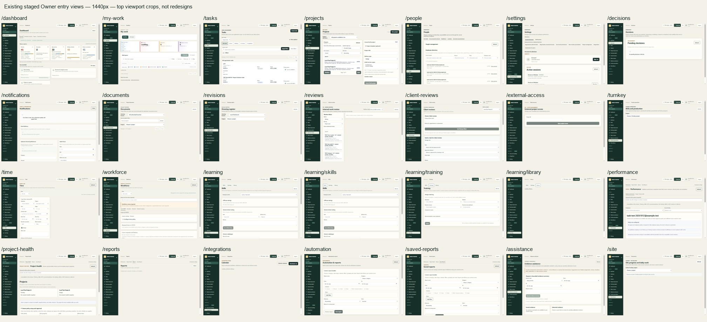
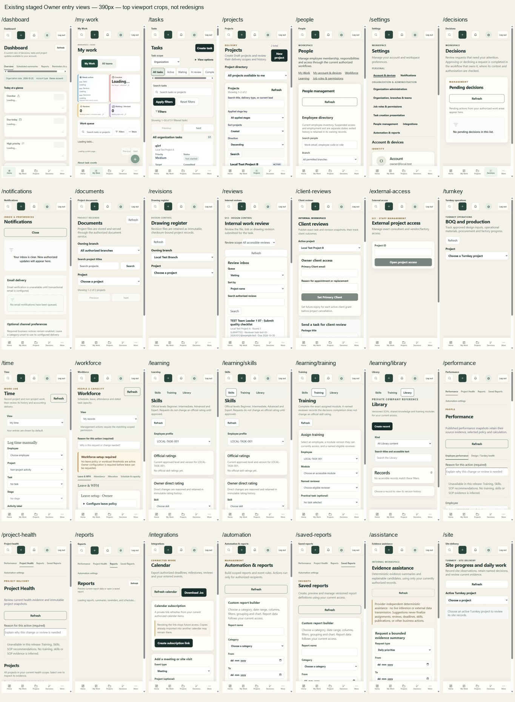

# Application UX audit — review package

**Revision2:** The Owner accepted this discovery baseline without authorizing implementation. Continue with the [revised master UX plan](revision-2/REVISED_MASTER_UX_PLAN.md), [interaction specification](revision-2/INTERACTION_SPEC.md) and [exact decisions](revision-2/DECISIONS.md). The original findings/evidence below are retained as historical baseline; revision2 adds real STAFF-role evidence and verified CLIENT/EXTERNAL absence.

25 October 2026 · **Findings and proposed master plan ready. Exhaustive cross-role audit remains IN PROGRESS.**

Start with the [master UX plan](MASTER_UX_PLAN.md). It contains the prioritized findings, simplified navigation, core journeys, unified component/system proposal, screen-by-screen roadmap, compatibility risks, usability criteria and controlled rollout gates.

- [Complete checkout route inventory and existing navigation](PAGE_INVENTORY.md)
- [Roles, permissions, workflow dependencies and missing coverage](ROLE_AND_WORKFLOW_MATRIX.md)
- [Approved demos, design assets and competitor research](RESEARCH_AND_REUSE.md)
- [Screenshots and evidence gallery](EVIDENCE_GALLERY.html)
- [Exact verification and coverage ledger](EVIDENCE_LEDGER.md)
- [Machine-readable audit summary](AUDIT_SUMMARY.json)

The recommendation is to retain the approved shell and canonical modules, strengthen selected-project context, simplify list/detail layouts, and separate daily operations from setup. No feature removal, new frontend, backend/API/schema/permission/business-rule change or implementation is included.

Actual Owner browsing covered all28 internal entries on desktop/phone, all8 Project sections, important read-only task/review/document/site contexts and the legacy CRM aggregate. The independent browser run captured196 anonymous/synthetic states. Synthetic sessions do not establish real employee/client/external permissions. Other authenticated roles, many populated states and empirical user testing remain open and are listed explicitly.

The existing matched local release70b047cd was inspected. The dirty checkout is a different source boundary. No deployment, migration, application test-suite pass, production acceptance or independent model review is claimed. Current Codex performed this work; no subagents were used.

## Visual index

These are actual current-state viewport crops. They are not proposed redesigns. Some views show legitimate source-loading or unconfigured states. Earlier full-page screenshots with unstable narrow-column rendering are retained separately in the gallery and must not be treated as verified layout defects.

