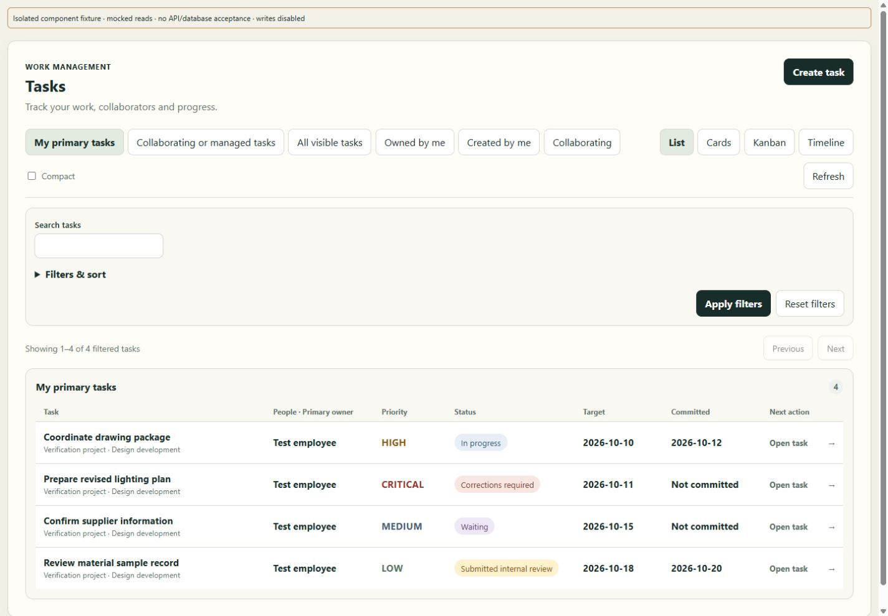
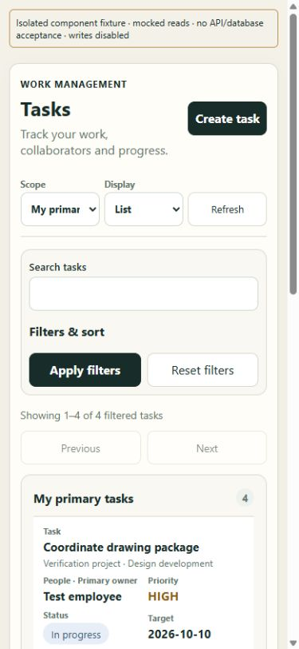

# MW-I01 implementation and verification report

9 October 2026. **Frontend implementation delivered; authenticated application acceptance remains pending. MW-I01 is not marked COMPLETE.** MW-I02–MW-I08 have not started.

## Implemented

- Clean white desktop Work Queue rows with Task/project/stage, **People · Primary owner**, canonical LOW/MEDIUM/HIGH/CRITICAL, full task status, separate Target/Committed dates and Open task.
- Status colors distinguish progress, waiting, review, corrections and approvals; text remains explicit. Priority is a separate field. No evidence-received/approved state is inferred from task status.
- Full-width list when no detail is selected. Container queries adapt rows to narrower desktop split panes and mobile widths.
- Mobile native scope/display selectors reuse the exact existing choices, with Refresh on the same compact row. One Create entry remains; no new navigation or FAB.
- Mobile controls retain 44px minimum heights. Native keyboard operation, visible focus and accessible row descriptions include primary owner, priority, status, both dates and reassignment warning.
- Existing list/cards/board/timeline views, pagination, URL/filter state, selection/Back, command handlers, reasons, capability checks and APIs are retained.

People uses only the authorized setup's primary-owner name and existing fallback. Collaborator, creator, assigner and reviewer identities are not manufactured or requested per row. Next action opens details; it is not a status-derived permission to mutate a task.

## Files changed

Production files:

1. `apps/web/src/task.tsx` — queue markup, accessible descriptions, responsive selectors and full-width queue class. Existing API/query/command handlers are unchanged.
2. `apps/web/src/task.css` — scoped queue surfaces/status/priority colors, container layouts and mobile controls/header sizing.
3. `apps/web/src/task.test.tsx` — two meaningful regressions covering all 13 states/four priorities, primary-owner fallback, distinct dates, reassignment warning, accessible descriptions, no per-row detail requests and selector/URL/selection/Back behavior.

Documentation: this report, `SPEC.md`, evidence logs/screenshots/manifests, and bounded status notes in CURRENT_STATE.md, IMPLEMENTATION_STATUS.md and IMPLEMENTATION_PLAN.md. No backend source, API contract, schema, permission, other module or production data was changed by this slice. Existing unrelated working-tree changes were preserved. Node/Prisma/build tools generated their ordinary ignored build/client outputs.

Ignored local verification tools under `.env.checkpoint-tools/` preserve the pre-edit TaskWorkspace source and provide a separate visual harness. It imports the real before/after component, supplies mocked reads and refuses mutations. It is not imported by application routes or production bundles.

## Before / after UX

| Before | After | Classification |
|---|---|---|
| Closed-detail list occupies a narrow column | Queue uses available width; split-pane rows adapt to container width | UX use of space |
| Person, status and priority mixed into metadata lines | Explicit primary-owner, priority, status and date fields | UX comprehension |
| Six scope buttons plus four view buttons stack on mobile | Native selectors retain options in one compact toolbar | UX access and scrolling |
| 390px component fixture first task begins at y=926px | Same fixture first task begins at y=671px, about255px earlier | Measured component result; not full-app usability acceptance |
| Uniform understated task metadata | White rows, readable semantic status badges and separate priority color/text | Cosmetic hierarchy plus accessibility |

The measured fixture does not include the app shell or My Work's independent attention sources. Their effect on above-the-fold content is still unverified. The preserved TaskWorkspace baseline was captured before code edits; populated comparison images render that archived component against the same mocked responses.

## Automated checks

Pinned Node **24.19.0**, pnpm **11.19.0**. The initially available pnpm11.25.0 was not used as acceptance evidence; nested commands were corrected to the existing pinned PATH. A sandbox EPERM resolving packages required approved execution outside the sandbox.

| Check | Before editing | After | Result / scope |
|---|---|---|---|
| Full web unit suite | 212 passed /19 failed of231;2 unhandled errors;32/34 files passed | 214 passed /19 failed of233; same2 errors;32/34 files passed | Same19 failing test names, no additional final failures; two added tests pass. |
| Focused Task + MyWorkAttention | Existing Task tests were among passing files | **26/26**,2/2 files | Final run after the last assertion; Task22/22, MyWorkAttention4/4. |
| Workspace typecheck | Exit0 | Exit0 | Contracts/API/web checks; generated Prisma client, no migrations. |
| Workspace lint | Exit0 | Exit0 | Existing ESLint command. |
| Production build | Not rerun before edits | Exit0 contracts/API/web; final affected web rebuild Exit0 | Existing large-chunk and ineffective gallery/external-portal dynamic-import warnings remain. PWA generation passed. |
| Diff whitespace | Baseline recorded | `git diff --check` clean for changed task files | No source reset or unrelated cleanup. |
| PostgreSQL integration / full verify | Historical failures documented; local servers initially offline | **Not run** | No new PostgreSQL result or full-application acceptance claim. |

Evidence is in `evidence/`: baseline/final web logs, focused log, typecheck/lint/build logs, failure-name lists, before tree/diff and task-source hashes. Comparing `baseline-failures.txt` with `final-failures.txt` yields no difference. A transient new-test landmark query failed during development; it was corrected, and both final focused and full-suite runs include passing new tests.

### Pre-existing failures

- `app.test.tsx`:18 failures; `workspace-navigation.test.tsx`:1 failure, present before TaskWorkspace edits. The shell tests expect earlier landing/navigation/authentication UI, and the baseline also has two Dashboard errors reading an undefined value. These are outside MW-I01; they were not silenced or changed.
- Historical PostgreSQL failures include reused-target singleton Owner collisions and missing template files, documented in `docs/ui/UX_CURRENT_VERIFICATION_2026-10-08.md`. They were not reproduced, repaired or classified as new failures in this frontend slice.
- Both preview57434 and accepted57433 were initially unreachable. The exact existing dedicated preview cluster57434 was resumed normally. Database115 readiness passed. No initialization, migration, reset or manual repair occurred. The preview has1 Owner and0tasks.

## Browser checks and screenshots

### Actual application

Actual Vite app at `http://localhost:59223/tasks`, current compiled API59224 and existing dedicated database115 were started/reused. Signed-out protection was observed before and after and captured. **Authenticated populated queue, command persistence, permission-revocation/ID-tampering and full app-shell responsive acceptance were not verified.** No test account, task or session fixture was inserted.

### Isolated component browser checks

CUA browser checks on the actual TaskWorkspace component with explicitly mocked, write-disabled reads verified:

- List → Cards → Kanban → Timeline → List and matching URL view state.
- Keyboard Tab produces visible3px focus; Enter opens a task; Back restores the queue/selection URL.
- Search/Apply returns matching fixture rows; Reset restores the fixture page.
- Existing Create form opens with original fields/types/priorities; no save was attempted or claimed.
- 320px,390px,1024px and1440px layouts without horizontal page overflow in the inspected fixtures; desktop split pane with queue width406px adapts to two columns.
- 320px Create/scope/display/Refresh heights44px. Sample status/priority text contrast calculations range5.51:1–7.24:1; this is a targeted color check, not a complete WCAG audit.
- The initial mobile header squeeze and muted status-color specificity defects were reproduced and corrected before final captures. Long closeout labels may wrap; their authenticated real-app case remains pending.

Review-only component preview: `http://127.0.0.1:59430/after.html`. This is **not** authenticated application acceptance.

| Screenshot | Meaning |
|---|---|
| [Before desktop](evidence/before-component-desktop.jpg) / [After desktop](evidence/after-component-desktop.jpg) | Real component with identical mocked reads |
| [Before390px](evidence/before-component-mobile.jpg) / [After390px](evidence/after-component-mobile.jpg) | Comparable component scrolling/control density |
| [After320px](evidence/after-component-320.jpg) / [After1024px](evidence/after-component-tablet.jpg) | Narrow/mobile and tablet checks |
| [Desktop detail](evidence/after-component-desktop-detail.jpg) | Container adaptation with selected detail |
| [Actual app before](evidence/before-actual-signed-out.jpg) / [Actual app after](evidence/after-actual-signed-out.jpg) | Signed-out route guard only |

## Remaining constraints and next authorization

MW-I01 needs authenticated actual-app acceptance before it can be marked COMPLETE. Automatic approval review **rejected** the proposed persistent fixture creation, citing the database-change restriction and incomplete fixture cleanup. The rejected command did not execute; it was not retried against another target or worked around. No production authentication bypass was added.

A bounded way to finish is an explicitly approved **separate disposable** database, e.g. `sense_mw_i01_validation_20261009_test`, using existing migrations/schema and uniquely named synthetic Owner/staff/employee/branch/team/task/session fixtures through the standard test workflow. Existing preview/source/accepted databases and operational records would remain untouched. Verification would cover real list/views/filters/selection, create/edit/progress/wait/resume and applicable denied/capability cases, with desktop/mobile screenshots. Fixture session expiry/revocation and disposal of that named test database must be included in the approval and cleanup plan. No backend behavior or contract change is proposed.

Additional gaps intentionally remain: unsupported row participant/assigner/reviewer metadata, full-app mobile hierarchy, exact compound metrics and dependent Team/calendar/saved-view features. Owner Q1–Q4 decisions are recorded in SPEC; they do not authorize subsequent slices.

**Recommendation for MW-I02:** finish MW-I01 authenticated acceptance first, then separately authorize personal action hierarchy and independent source recovery/count labels. Keep typed decisions and exact reviewer inbox separate from personal tasks. Do not begin MW-I02 now.

Routing actually used: GPT-6.1 Sol for context, scope and final source review; GPT-6 Luna for the settled frontend implementation. No measured70/30 allocation or full-runtime Sol acceptance is claimed. Refero traceability remains the approved prototype/Blueprint section20 plus existing SC15/SC06 ledger; no fresh broad research or copied screen was needed.
