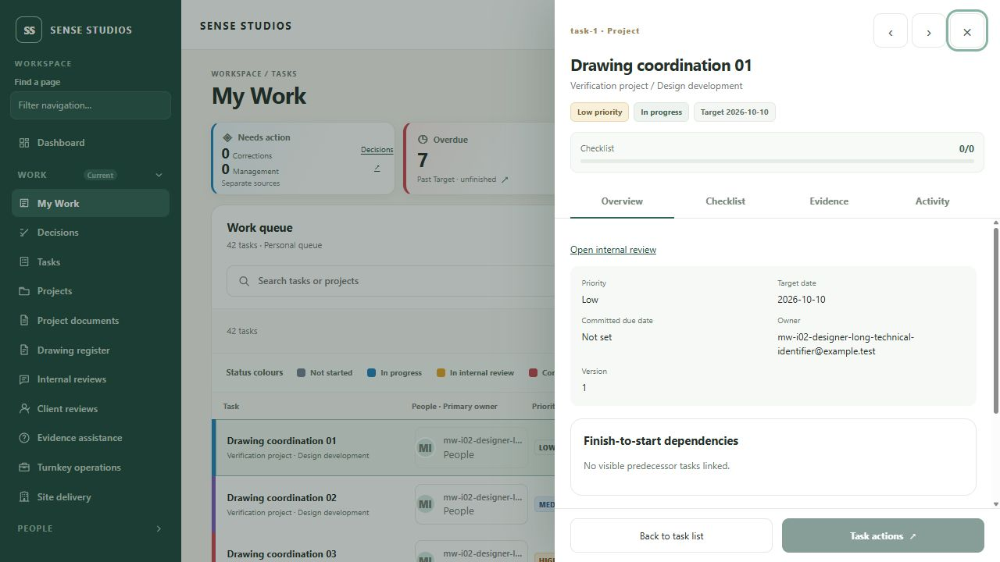
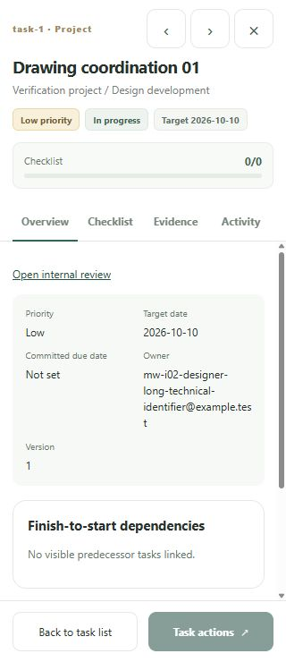

# My Work task-opening presentation — 13 October 2026

## Result and boundary

My Work now opens canonical task details in a right modal panel on desktop/tablet and a full-viewport panel on mobile. The queue stays behind the panel. Existing `/tasks` and legacy callers retain their inline detail presentation.

**Affected frontend checks: PASS (141/141).** The 17 focused drawer checks also pass; web TypeScript, repository ESLint and production web build pass with Node24.19.0/pnpm11.19.0. Exact logs/results are under `accepted-source/`. Prior full-suite baseline debt of20 failures remains separately tracked; a full suite and authenticated acceptance were not rerun here.

This is frontend implementation/component evidence. Current-source full authenticated Prototype Visual Fidelity remains **BLOCKED/pending** a separately authorized acceptance run and Owner review. It does not replace prior accepted functional evidence, mark MW-I02 COMPLETE or start MW-I03.

## Changed frontend files

- `apps/web/src/task.tsx` — My Work drawer integration; canonical content/handlers retained; checklist/activity sections and exact review link; previous/next among loaded authorized tasks; dirty/busy departure guard and query restoration.
- `apps/web/src/task-detail-drawer.tsx` — native dialog, focus/scroll management, four accessible tabs, fixed header/footer and responsive frame.
- `apps/web/src/task-detail-drawer.css` — source-matched drawer geometry and demo palette/proportions with readable touch targets.
- `apps/web/src/task.test.tsx` — local native-dialog test support and cleanup; existing assertions retained.
- `apps/web/src/task-detail-drawer.test.tsx` — nine frame cases.
- `apps/web/src/task-my-work-drawer.test.tsx` — eight integration cases.

No API, schema, permission or database change. No service restart, authenticated test run, synthetic fixture write or disposable database operation was performed for this work.

## Reference comparison

Exact approved Final_Demo.html SHA256: `F8C18088E04C72ACEE34C38BDB458BF84FC8CF9FC834667A75E3D5A3D95C59B8`.

| Detail | Implemented |
| --- | --- |
| Desktop right-side drawer | 570px at1440 and1024; white surface with dimmed retained queue |
| Mobile drawer | Full viewport at390×844 and320×740 in the responsive component checks |
| Header and tabs | Task ID/type/title/project-stage/priority/status/Target; Overview, Checklist, Evidence, Activity |
| Body and footer | Body scrolls independently; fixed footer keeps Back and Task actions accessible |
| Navigation | Previous/next among the current loaded filtered page; URL/query/view/page retained; Escape/backdrop/close and keyboard tabs |
| Existing commands | Edit, transitions, waiting/resume, assignment, dependency/date/extension/recurrence/closeout forms and review links remain capability-gated |

Backend-driven differences: checklist updates use the existing audited edit command; evidence opens the exact authorized review workflow. No simulated evidence upload/progress, timer, invented reviewer/assigned-by data or fictional subtasks. Real subtasks and the unified work-now projection are planned separately. Shared-shell differences remain outside this change.

Direct browser navigation to the supplied file protocol was blocked by browser policy. Its read-only source and existing approved captures were inspected; no indirect serving/browser workaround was used. Exact fresh prototype drawer screenshots are not claimed.

## Responsive component measurements

The four-width captures and `COMPONENT_GEOMETRY.json` in this directory record the styling-verified component before final focus/draft/identity corrections. Those later corrections did not change the CSS geometry. They are explicitly synthetic, not authenticated screenshots.

| Viewport | Drawer width | Header bottom | Body height | Footer top/bottom | Horizontal overflow |
| --- | ---: | ---: | ---: | --- | --- |
|1440×900|570|279.78|551.22|831 /900|None|
|1024×900|570|279.78|551.22|831 /900|None|
|390×844|390|270.39|504.61|775 /844|None|
|320×740|320|270.39|400.61|671 /740|None|

Each tab has a44px height. The native modal covers the fixed application navigation and isolates background controls. At320×740 the body has400.61px of scrollable area above its69px footer. Technical identifiers wrap without page overflow.

After the browser connection changed, its documented viewport override stopped applying: requested320×740 remained1280×720. The final-source capture is therefore labeled at its **actual1280×720** size in `accepted-source/component-drawer-current-default.png` and `CURRENT_DEFAULT_GEOMETRY.json`. No layout manipulation or alternate browser workaround was used; a final-source four-width capture remains pending. The earlier source-refresh/resize-interrupted artifacts are retained and excluded from passing screenshot evidence.

## Regression findings resolved

- Browser Back now observes dirty/busy task departure guards instead of silently discarding a form.
- Dirty tracking resets with the authoritative detail result before rendering, avoiding a deferred reset overwriting a subsequent user edit.
- A reassignment capacity warning is bound to its original task and cleared on departure; its payload cannot be acknowledged against another selected task.
- Modal focus restoration occurs before the parent reveals/focuses a newly selected queue, preserving existing card-filter keyboard behavior.
- Previous/next focus is restored after detail loading; hidden panels remain mounted so changing tabs preserves an edit draft.
- Loading/unavailable details do not display fabricated zero checklist totals; capacity warnings and success/error feedback remain accessible inside the modal.

Early logs preserve a package-runner timeout, strict test typing/selector issues and three actual queue-focus regressions. These were corrected and the final141/141 pass retains the original assertions. No known baseline failure was relabeled a new application defect.

## Remaining work

1. Actual final-source authenticated four-role/task-command/viewport validation requires its bounded authorization; no approval from the earlier consumed runs is reused.
2. The Owner requested role-specific demo creation forms, then selected **backend role-profile plan first**. Creation access/defaults and the current form remain unchanged here.
3. The actionable queue/subtask gap report records the Owner's new rule: each subtask has its own assignee/Target/workflow, with parent completion gated until every subtask completes. No subtask contract was implemented.

Routing used GPT-6.1 Sol for intake and security/contract review, GPT-6 Luna for the frame and focused tests, and primary integration/corrections. The Luna follow-up reached its usage limit; the primary finished verification without claiming another model ran. Sol review found the Back-navigation and reassignment-warning issues, both now regression-covered.

Final GPT-6.1 Sol file-only acceptance review: **PASS** for bounded source/evidence. It confirmed both reviewed defects resolved, the141/141 and17focused/gate results, accurate capture limitations and no material unresolved regression. No independent live/authenticated test was claimed.
