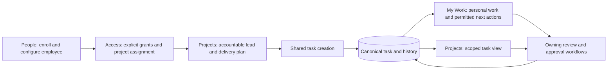

# Sense Studios V1 — internal pilot delivery plan

Date: 15 October 2026 (Asia/Calcutta). Status: **IN PROGRESS; Owner authorized starting delivery. Pilot acceptance is not claimed.**

First batch: V1-00 source/runtime baseline, V1-01A permission catalogue and the existing task-description validation correction. See the [delivery progress and exact checks](V1_DELIVERY_PROGRESS_2026-10-15.md). Remaining package gates stay open; source verification does not imply whole-app or pilot completion.

The Owner subsequently requested an active goal to complete V1. [People and focused Settings source delivery](V1_PEOPLE_SETTINGS_PROGRESS_2026-10-15.md) is the next implementation batch; its exact checks and incomplete acceptance boundaries are recorded separately. Goal remains active.

Further source delivery is recorded in [shared task composer progress](V1_TASK_COMPOSER_PROGRESS_2026-10-15.md): current-context participants and ordinary/subtask shared fields. The plan's original remaining-work descriptions below are acceptance targets; use the dated reports to identify what is already implemented.

The Owner then assigned this agent D/G followed by E, with C handled by the other agent, and explicitly created an Agent1 goal. [Project Tasks/People integration](V1_AGENT1_PROJECT_PROGRESS_2026-10-15.md) and [E query source/evidence](V1_AGENT1_QUERY_PROGRESS_2026-10-15.md) record implemented source and remaining acceptance. The Owner subsequently approved the [bounded task receipt design](V1_TASK_CREATE_RECEIPT_PROPOSAL_2026-10-15.md); [receipt source/evidence](V1_AGENT1_RECEIPT_PROGRESS_2026-10-15.md) prepares migration119 and same-command recovery. It is not applied to retained/production databases. Real persistence/concurrency/authenticated/pilot and whole-current-tree acceptance remain open; current reports retain failed gates and concurrent-source boundaries.

The Owner also supplied an additional eight-slice V1 plan. Its [source-grounded comparison and corrections](V1_ADDITIONAL_PLAN_REVIEW_2026-10-15.md) retains compatible Settings, query, notification and responsive refinements while correcting stale implementation/environment claims, Staff access assumptions, presentation-versus-authority confusion and the proposed saved-view storage change. The additional plan does not replace the source of truth or restart implemented slices; unapproved data/workflow proposals remain explicit.

The Owner selected **an internal pilot with real staff**, with production release as a separate milestone. The Owner also wants to create tab demos in ChatGPT and return them for integration. This plan therefore pairs the delivery work with a [backend and demo contract](../v1-demo/BACKEND_CONTRACT.md) and [copyable demo instructions](../v1-demo/README.md).

## 1. What V1 must accomplish

A person can sign in, see only permitted information, find the work requiring their action, create or receive a task, work on it in its project context, submit it for the required review, handle corrections, and complete it with preserved evidence. The Owner can onboard people, configure the organization and access, recover access, and safely remove access without losing history.

The central acceptance journey is:

My Work and Projects display the same task ID and workflow. People, job roles and presentation profiles never create a second authorization system.

**V1 scope:** access control, shared UI/navigation, dedicated People management, usable Settings panels, one shared task composer, coherent My Work, coherent Projects, and the existing review/document/notification workflows needed to finish real work. Existing modules and deep links remain available under their ordinary rules. Design is the recommended first operational pilot; Turnkey enters the pilot only after its applicable delivery and R-105 gates are met.

**Deferred expansion:** new analytics, live AI/inference, external AI transmission, new accounting/payroll/provider integrations, WhatsApp, deep CAD/BIM, new organizational tiers, arbitrary custom workflow builders, a new permission engine, and replacing the application framework. Existing S27 remains deterministic, provider-neutral and human-decided. The S27 R-104/R-105 waiver applies only to its accepted bounded implementation.

## 2. Evidence and current gaps

The initial planning baseline was a source/document inspection of HEAD `3f06f9c` plus a substantially modified and untracked working tree. HEAD alone does not identify the inspected candidate. No runtime or quality gate was run during that initial planning pass. Subsequent delivery checks and corrected gaps are recorded separately in the progress report linked above; the following table preserves the starting audit.

| Area | Inspected current structure | V1 work |
| --- | --- | --- |
| Access | Server sessions, scoped role permissions, explicit employee allow/deny overrides, branch/project checks and resource capabilities already exist. | Build understandable administration and prove the complete allowed/denied journeys against current source. |
| Settings | `/settings?section=account|notifications|organization|team`; organization and team components are embedded in `app.tsx`. | Separate focused panels, save/error/conflict states and links to People; retain existing authentication and fresh-sign-in checks. |
| People | No dedicated `/people` route. Owner employee management and staff reporting-tree management live inside Settings. Navigation's People label groups Time/Workforce/Learning. | Dedicated directory, person detail, onboarding and access lifecycle using current scoped services. |
| Permission editor | Owner enters `permissionKey` as free text. | A source-derived, validated permission catalogue with readable action/scope labels. Do not seed guessed permission names or grants. |
| Names | Inspected Account/Employee schema has email and employee code, without a stored employee display name; several APIs return email as `name`. | Proposed optional stored display name, Owner-maintained with audit and honest legacy fallback. Schema and field policy need an explicit decision before implementation. |
| Task creation | Shared native dialog exists; form and POST construction remain inside `task.tsx`. API accepts `reviewRequirement`, but the inspected main form does not expose it. | Extract one typed composer and command adapter; support personal, project and permitted subtask entry points. |
| Validation | Create UI permits 4,000 description characters; create API accepts 2,000. | Reproduce the mismatch and align limits/validation; include boundary coverage. No fix was made in this task. |
| My Work | Personal queue, role presentation, metrics, preferences, task drawer and typed task/review/approval composer source exist. | Finish current-source acceptance; preserve settled count/filter/snapshot rules and improve remaining usability through bounded slices. |
| Projects | List/detail, plan and management commands exist. Tasks/Documents/Reviews/Delivery sections currently link to other workspaces. | Make it a coherent project workspace, with the shared task view and composer in project context; retain canonical document/review workflows. |
| Reliability | October 14–15 notes report passing source/unit/build checks, but current PostgreSQL/browser acceptance remains open. There are 118 source migration directories; retained preview records distinguish earlier 115-compatible data/runtime. | Reconcile the exact candidate/runtime/database version and obtain fresh evidence. Source directory count is not applied migration status. |

Historical S01–S27 completion remains valid only within each accepted source and environment boundary. The old S18/S27 exclusions in historical documents are superseded by the current Owner direction. Historical test totals are not a current-tree PASS.

## 3. Requirement and module boundary

The approved requirements/addenda and explicit later Owner decisions govern behavior. This V1 plan organizes delivery; it does not change those rules. Existing slice IDs remain intact; `V1-*` below are coordination packages, not replacement S-slices.

| Package | Requirements and relevant subclauses | Owning modules / dependencies |
| --- | --- | --- |
| V1-00 Candidate and runtime | R-099–R-102; existing acceptance/preservation protocol | FND; existing runtime, CI and acceptance harness |
| V1-01 Access | R-004.a–d, R-006.a–c, R-007.b, R-008.a, R-009.a, R-079/R-080/R-092/R-099; C-001/C-023/C-024 | IDN, ORG, ACC, AUD; S02/S03/S04/S07/S09 |
| V1-02 UI foundation | Existing approved shell/UI direction; R-005–R-009/R-099; supported domain contracts | Shared frontend shell; preserve actor/session boundaries |
| V1-03 People | V1-01 clauses plus employee lifecycle C-023.a–b/C-024.a | ORG/IDN, with TSK/PRJ/TIM exit consequences; WFM read links only within scope |
| V1-04 Settings | R-004/R-006/R-007/R-079/R-080/R-092/R-099, C-008/C-009; current S10/S17/S24 configuration | Owning identity, organization, notification and policy services |
| V1-05 Task composer | R-018.a–b, R-019.a–c, R-020.a, R-021.a–b, R-022.a–b, R-023.a–c, R-024.a–b; S10/S13/S14; approved subtask and presentation decisions | TSK/PRJ/ACC/REV/APR; WFM capacity, DOC evidence |
| V1-06 My Work | V1-05 plus R-025.a–d/R-026.a–b, R-027.a–b/R-028.a–b/R-029.a–b/R-037, R-096/R-097 | DASH/TSK/REV/APR read composition; no generic write lifecycle |
| V1-07 Projects | R-011.a, R-012.a–b, R-013.a, R-014.a–b/R-015.a–b, R-016.a–c, R-017.a–e; C-010–C-016/C-024 | PRJ/TMP/TSK/DOC/REV/APR; retain SITE/TURNKEY boundaries |
| V1-08 Pilot acceptance | R-104 actual Design journey; R-105 separately for real Turnkey use; relevant R-099–R-102 | All affected modules plus operations and Owner acceptance |

## 4. Proposed navigation and UI contract

Keep Dashboard as the established signed-in landing destination unless the Owner later changes it. Make My Work, Projects and People easy to reach. Keep Tasks as a broader authorized work view, with Decisions, Notifications, Documents, Reviews and other existing modules accessible through grouped navigation. Settings has a stable utility position. Mobile exposes the most-used destinations and an accessible More sheet; do not turn every module into a bottom-bar icon.

`/people` and focused person/settings routes are proposed additions. Existing query URLs, task/project/round/request IDs and browser Back/Forward must continue to work. Changing a URL or navigation label cannot grant access.

Use the latest Owner-approved My Work Final Demo as the primary reference for its covered surfaces. Retain its verified reference and existing contrast exceptions. For remaining screens, extend shared tokens and interaction patterns. The October 8 studio direction is historical where the later Final Demo supersedes it. Do not silently select a new palette/font system while integrating returned demos.

Shared components: page header, primary/secondary actions, search/filter toolbar, applied chips, table/list/mobile rows, avatar/people picker, semantic status/priority badges, empty/error/denied/stale panels, paginated results, contextual action forms, modal/drawer and unsaved-change handling. Define tokens once; avoid another layer of route-specific CSS overrides.

The design detail to preserve across demos is **clear responsibility and the next permitted action**, including the distinction between Target and Committed date. A colored badge alone must not imply approval or completion authority.

Design references retrieved on October 15 were metadata/style/flow research, not live usability tests:

| Decision | Reference / bounded use |
| --- | --- |
| Dominant visual treatment | Owner's Final Demo and retained application design lock; external references cannot override them. |
| Compact task essentials and optional planning | [Asana composer](https://refero.design/pages/81126272-7b9e-4983-a766-6d96fbee3c98), [Linear composer](https://refero.design/pages/29bf47bf-7741-48d3-8aaf-7a58e24ba2c1): field grouping and searchable ownership only. |
| Visible create/save/list feedback | [Programa assigned-task flow](https://refero.design/flows/13442): capture → date/owner → save → visible task; no imported lifecycle rules. |
| People list and focused access controls | [Tango members](https://refero.design/pages/fa6a0377-1d28-4bc0-9cd5-01d887cba04a): searchable member rows and distinct categories; no blanket member-wide permissions. |
| Project context and view controls | [Hello Ivy project board](https://refero.design/pages/6e885ff3-df28-46a7-83c2-3888e8c4f07a): project identity and scoped views; existing Sense states remain authoritative. |
| Consistent low-noise controls | Retrieved Superthread/Todoist style references: hierarchy and restrained control treatment only; reject their marketing composition, palette and decorative typography for these app screens. |

Before building a returned demo, record which reference owns each major component/token. Check actual integrated screens at 1440, 1024, 390 and 320px, keyboard-only operation, visible focus, readable contrast, touch targets and short mobile viewports. Component renders alone do not establish authenticated acceptance.

## 5. Execution packages and completion criteria

### V1-00 — Establish one current, reviewable candidate (P0)

Inventory staged/unstaged/untracked work without discarding it. Record the application source fingerprint, exact migration chain, toolchain, test harness, runtime manifests and retained-data boundaries. Classify old reports by source and supersession instead of treating the latest paragraph in every file as a consistent acceptance record.

Finish the existing MW-I02 candidate readiness and its current-source acceptance before starting gated MW-I03 or later My Work extensions. The October 14 stop-on-source-drift condition remains in force; do not reuse its one-run approval for a changed candidate. Prepare the concrete run and request any genuinely required fresh runtime approval only at execution time.

Acceptance: a recorded candidate, known runtime/schema identities, current defect list and exact verification route; accepted prior data/credentials/previews preserved. No convenient reset, migration on a retained target, guard bypass or simulated CI environment.

### V1-01 — Make access understandable and enforceable (P0)

Keep the current default-deny evaluator and deny precedence. Inventory real permission keys from callers/tests, their allowed scopes and workflow conditions; map each screen/action to its owning check. Replace free-text administration with readable grouped selections while preserving unknown historical grants for review rather than silently deleting them.

Add a proposed Owner/scoped-manager effective-access explanation read model if existing responses cannot supply it: target, resource context, effective result, matching allowed rule/deny, expiry and missing membership. It must call the existing evaluator and reveal only information the operator may manage. A preview of access changes remains a proposal until the real command succeeds.

Acceptance: role names/presentation do not grant access; task management, deadline control, review, file access and personnel management remain distinct. Test forged IDs, direct URLs, counts/pickers/exports/streams, cross-branch assignment, explicit denies, expiry, logout/revocation and actor switching. A Project Lead does not gain Owner-only employee/project-assignment/lead appointment powers.

### V1-02 — Build the shared UI foundation (P1)

Create only reusable components needed by the returned tab demos. Standardize navigation, forms, field errors, confirmation/reason flows, list/detail context and loading/denied/stale/conflict states. Retain actor-keyed mounting and late-response guards. Add no frontend role switcher to the real application.

Acceptance: one consistent shell/component vocabulary, accessible desktop/mobile behavior and preserved deep links. Backend authority controls the actions offered; direct API requests independently enforce it.

### V1-03 — Deliver People management (P0/P1)

Create a dedicated People destination. Owner sees the permitted employee inventory and onboarding state; a manager sees the existing same-team/branch reporting descendants only; ordinary staff gets self information and links to existing personal workflows. A company-wide staff directory would be a separate access decision, not a default.

Person detail separates identity/enrollment, home branch/team, reporting manager, job roles, effective access and project assignments. Workload/leave/skills links use their owning services and permissions; missing schedules never become fabricated capacity values. Suspension, exit and reassignment are separate named actions with reasons and impact information.

Onboarding: invitation → accepted identity/passkey → employee/home membership → explicit roles/grants → explicit project assignment → usable My Work. Do not show a partially configured account as ready. Exit retains C-023 Waiting/reassignment and C-024 project-hold behavior atomically; suspension must not be presented as employee exit.

Acceptance: Owner can onboard one real pilot employee through ordinary UI; scoped managers cannot edit a peer/other branch; exited people retain history; exit revokes access and preserves task/project consequences. Any display-name migration is additive, with legacy fallback and no email-derived invented names.

### V1-04 — Deliver focused Settings panels (P1)

Separate personal Account & devices and Notifications from Owner Organization, Branches & teams, Job roles & access, Task/workflow configuration, and operational status. People links to the dedicated People area rather than duplicating its full editor. Workforce/retention/template configuration remains with owning services and only implemented options are editable.

Each panel has a clear current value, local draft, Save/Cancel, field errors, pending/success state, conflict handling and required reason/fresh sign-in. Reauthenticate through the existing flow and preserve a safe draft when an access change requires recent sign-in. Show the actual setting version where used; do not invent `expectedVersion` on commands using another concurrency contract.

Operational configuration shows configured/unconfigured/failed state honestly. Do not add editable provider secrets or unsupported defaults. Permission administration is Owner-only under the inspected controller; a label such as Admin does not delegate it.

Acceptance: a saved setting survives refresh and changes its intended behavior; unauthorized direct writes fail; one panel cannot submit stale values belonging to another panel; no guessed numeric leave/capacity/retention policies.

### V1-05 — Deliver one task creation form (P0/P1)

Use a single typed composer and command adapter from My Work, Tasks, Project Tasks and permitted parent-task detail. Always collect Task name, one Primary owner, Priority, Type and Target date, plus the currently required reason. Show essentials first and progressive optional planning. Keep project/stage context when launched from a project; personal creation defaults to self only when a real employee identity exists. An employee-less Owner chooses an eligible employee.

Use authorized, context-valid project/employee/plan-item choices. Setup's broad `canAssign` is not proof that every offered employee is eligible for every project; add a scoped assignment-options read if necessary. Do not automatically grant project access from a picker. Clear incompatible stage/participant values when context changes.

Expose supported review requirements with clear wording and owning review/reviewer planning; separate operational Target from committed-date commands. Attachments, dependencies, recurrence and formal correction/training/site workflows use real existing contracts, not fields whose labels pretend to execute them. Checklists remain separate from real subtasks.

Align frontend/API validation, including the observed 2,000/4,000 description mismatch and existing tag/checklist limits. Preserve drafts after recoverable failures. Resolve ambiguous create outcomes without encouraging blind duplicate submission; assess and, if needed, design bounded durable create idempotency using existing receipt conventions. Such an addition is a reviewed backend change, not a demo promise.

Acceptance: a created task persists once, appears in its intended Project and permitted personal views, updates relevant totals, and opens by its returned canonical ID. A manager assigning someone else does not falsely add the task to the manager's personal-owned queue. Test invalid people/project combinations, capacity acknowledgement, stale parent context, submission failure and ordinary versus review-required completion.

### V1-06 — Finish My Work as a daily workspace (P0/P1)

Preserve already-settled rules: personal tasks are distinct from organization/team/site views; Needs action composes source-qualified task/review/approval items; task reasons deduplicate by task ID, while a real review round or decision remains its own obligation. Keep separate source counts, one authorized snapshot/clock and global server ordering/pagination. Task-only filters visibly select Tasks; Clear restores mixed work and prior filter context.

Preserve empty Owner personal counts, independently visible management reassignment holds, Waiting semantics, organization-day Overdue and no fabricated upload metric. Role presentation is server-derived; explicit grant/resource checks determine actual second-scope visibility. Keep existing list/cards/board/timeline and account-scoped local preferences without promising server-synced views.

Connect rows to the same task drawer, exact review round or owning approval workflow; preserve scroll/filter/page/focus on return. Counts refresh after successful mutations, and denied/unavailable/stale is never displayed as zero. Parent completion waits for every real child to be completed across ordinary/internal/client completion paths, including concurrent commits.

Acceptance: Owner, manager, employee, site staff and named reviewer can find their true next action; inaccessible records do not enter rows, totals or option lists. Verify completed/waiting/correction/review/expired-decision and actor-switch scenarios on current source and real persistence.

### V1-07 — Deliver a coherent Projects workspace (P0/P1)

Keep a searchable, paginated project list with authorized branch, lead, delivery type, status and next milestone. Expose only API-supported filters; any new status/type/count projection needs its own contract. Selecting a project preserves list context and gives Overview, Plan, Tasks, People, Documents, Reviews, Delivery and Activity sections.

Project Tasks embeds/reuses the canonical task list and composer with fixed project context. People shows current project contributors/lead; Owner controls assignment and lead changes under current APIs. Documents, reviews and delivery show authorized summaries/context and open canonical workflows; do not duplicate formal approval or file handling. Display no invented health/progress/financial totals.

Project creation groups title, owning branch, Design/Turnkey, service scopes and optional client/template/Won-lead provenance. Make setup to Active explicit: eligible assignment and accountable lead, plan/gates and state command. Changing scope, branch, lifecycle, lead or cancellation uses its current command/reason/approval contract.

Acceptance: create → configure → activate → add task → work/review/correct → complete required gates; forbidden lifecycle shortcuts fail. On Hold/cancelled/archive states have correct permitted actions; cancellation and exit cannot erase task/revision history. Owner-only cancellation and native CAD revocation/client expiry prerequisites remain.

### V1-08 — Verify, then run the staff pilot (P0)

Use Node 24.19.0/pnpm 11.19.0, frozen installation and Prisma generation. Run meaningful focused regressions during implementation, then full typecheck/lint/unit/integration/build/browser acceptance on the unchanged candidate. Use `VITEST_WORKERS=2` for the documented host resource limit.

`pnpm verify` includes database integration and browser tests; it is not a database-free local gate. The current guarded CI runners provision disposable PostgreSQL fixtures. Use the real configured CI path or a separately reviewed supported dedicated local acceptance path. Do not set fake CI flags or weaken target guards to make an environment pass. Include the current subtask migrations/committed-transaction races and G08 permission-revocation approval paths, not only old suites.

Before real staff writes: accept security and persistence gates, validate the exact pilot host/storage and HTTPS/passkey origin, establish working backup/key custody and rehearse restoration of pilot database plus file evidence. A separate pilot database/storage root must not overwrite retained previews or test data. Use ordinary onboarding; no fixture accounts, persona switcher or shared Owner credentials in pilot.

Start with the Owner, a scoped manager/Project Lead, employee and independent reviewer on one actual Design project. Record problems in-app and verify task, review/correction, client approval, final drawing issue and handover for R-104 using applicable external-access/provider gates. If initially running only staff tasks, report **task-only pilot**, not full R-104 acceptance. Add site staff/actual Turnkey only after the corresponding safety and R-105 workflow checks; do not call the S27 waiver operational acceptance.

No promised calendar deadline before V1-00 establishes the candidate and harness. Re-estimate after baseline readiness and after the first accepted returned demo. Track work by completed acceptance gates rather than screen count or historic test totals.

## 6. Release acceptance checklist

| Gate | Required evidence |
| --- | --- |
| G0 Candidate | Source/config/toolchain fingerprint; retained-data boundaries; current migration status and schema compatibility; MW-I02 closure before gated extensions |
| G1 Access | Positive and negative HTTP/persistence tests across Owner, manager, employee, site, reviewer, cross-branch and portal identities; immediate revocation and actor-switch evidence |
| G2 People/Settings | Ordinary onboarding, scoped management, persisted saves, fresh-sign-in recovery, explicit grants and reasoned lifecycle; atomic exit consequences |
| G3 Task flow | One composer across callers; actual persistence and ownership; validation boundaries; ambiguous-response/retry handling; capacity and review gating |
| G4 My Work/Projects | Same canonical records; exact counts/page/scope agreement; mixed-source identity; context restoration; parent/child/dependency and completion races |
| G5 UI | Actual authenticated captures at four widths, empty/loading/error/denied/stale/conflict states, keyboard/focus/dirty forms and long content; review against returned demo |
| G6 Regression | Full applicable pinned quality gates and real configured hosted CI for the candidate; exact counts/failures/skips/retries, no inherited PASS claims |
| G7 Pilot entry | Accepted candidate, named users/access, pilot host and file-storage validation, backup/restore and rollback/recovery runbook, Owner pilot acceptance |
| G8 Pilot exit | Actual staff usage and R-104 evidence; separately scoped R-105 evidence where claimed; no unresolved data-loss/access/approval blockers |

Required journeys include ID tampering and wrong-branch search/count/stream denial; session loss while a read or form is pending; same-account token rotation; task creation from both entry points; review correction/resubmission; stale writes; employee suspension versus exit; project lead exit; cancelled-project restrictions; invalid child cycles and simultaneous child creation/parent completion. Full visual fidelity and functional reliability receive separate results.

## 7. Demo-first collaboration and decisions

The Owner creates one demo per tab using the shared contract and prompt, then returns its source/assets and behavior notes. Review each against backend capabilities before integration. Preserve its approved UI where compatible; list any new workflow/data/permission requirement explicitly. An attractive control cannot silently invent an endpoint or authority.

Demo order: **shared shell → task creation → My Work → Projects → People → Settings/access**. This allows consistent task and person examples across screens. Engineering order remains the dependency sequence above; visual exploration does not start gated implementation.

Already settled and not reopened: Branch-only hierarchy; one task owner; required Target; controlled Committed date; server role presentation; Employee fallback; source-qualified Needs action; one snapshot; one-level same-project subtasks; human approvals and current cancellation/exit rules.

Proposals requiring a bounded decision before dependent code: employee display-name field/edit policy; exact additional People/access-explanation read contracts; and any genuinely new behavior introduced by returned demos. The permission-catalogue read is now implemented in the first authorized delivery batch. Recommended People scope preserves current Owner/report-tree/self authority. No broad new access is implied by this planning request.

**Definition of V1 complete:** G0–G8 pass for the expressly selected pilot scope on the accepted candidate and the Owner accepts the operational result. Production NAS/public rollout, encrypted offsite/production key/restore validation, providers/legal/accounting and full R-105 remain separate gates wherever not actually exercised. No model-specific independent acceptance was performed in this planning session; report actual routing when that work runs.

## 8. Engineering pointers

Existing implementation: `apps/web/src/app.tsx`, `workspace-navigation.tsx`, `settings-homes.tsx`, `task.tsx`, `task-create-dialog.tsx`, `task-detail-drawer.tsx`, `project.tsx`, `projects-route.tsx`; API `authorization.service.ts`, `organization.controller.ts`/`.service.ts`, `task.controller.ts`/`.service.ts`, `my-work.controller.ts`/`.service.ts`, `project.controller.ts`, `project-workflow.service.ts`; contracts `packages/contracts/src/my-work.ts`; schema `apps/api/prisma/schema.prisma`.

Read alongside `CURRENT_STATE.md`, `IMPLEMENTATION_STATUS.md`, `IMPLEMENTATION_PLAN.md`, the approved requirements and clarifications, `PERMISSIONS.md`, `WORKFLOWS.md`, `DATABASE.md`, `FILE_STORAGE.md`, `TESTING.md`, the October 13 completion/acceptance plans and consolidated My Work parity plan. This document does not overwrite their historical evidence or run authorizations.
