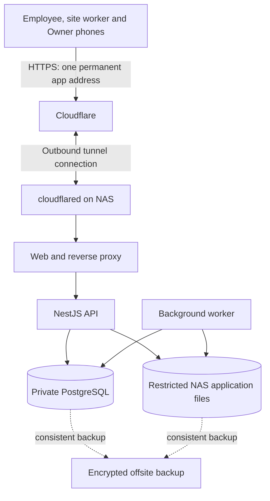

# NAS hosting and phone deployment proposal — 16 October 2026

Status: planning proposal, not deployment authorization or production acceptance. The Owner confirmed a MINISFORUM “Air5” with 8 GB RAM in this conversation; the existing architecture calls it N5 Air. Verify the exact model and installed MinisCloud version before selecting images or storage paths. Size against the confirmed 8 GB, not a vendor's larger reference configuration.

## Recommended approach

Host one production instance on the personal NAS. Give employees, site workers and the Owner the same installable progressive web app (PWA), with their existing server-enforced permissions. Publish one permanent HTTPS address on the existing domain through the already approved Cloudflare Tunnel. Build and test releases on a development machine or CI; the NAS pulls tested images and runs them.

This reuses the current React/Vite PWA, NestJS modular monolith, PostgreSQL, worker and NAS document storage. It avoids maintaining separate mobile applications during launch. Native wrappers remain deferred under R-072.b. Eight GB is a reasonable candidate for a lean pilot, not a proven capacity result: available memory, file serving, NAS services, disk latency, concurrent use and home upload bandwidth must be measured.

The backup arrows describe a dedicated backup operation, not built-in continuous replication. Cloudflare carries public app traffic; NAS hosting does not make that traffic invisible to the ingress provider. [Cloudflare documents an outbound tunnel without a public origin IP or inbound port forwarding.](https://developers.cloudflare.com/tunnel/)

## Approved boundaries and requirement map

| Requirement/source | Deployment work |
| --- | --- |
| R-035/R-036/R-039; S11/S12 | NAS remains primary file storage; backend file authorization; restricted absolute mount; immutable revision/checksum evidence. |
| R-071/S22.a, R-072.a/b | Installable responsive PWA first; native wrapper deferred. |
| R-098.a–g; S22_SPEC.md | Preserve supported offline site capture, stable identities, replay protection, explicit conflict resolution and online reauthorization. |
| R-006/R-092; C-001/C-002 | Enforce organization, branch, team and explicit project-assignment boundaries on the server. |
| R-099; C-008 | Passkey sign-in, device/session revocation, Owner recovery and approved launch messaging. |
| R-079/R-080; C-003/C-009 | Preserve audit, approval/file evidence and approved retention/holds through deployment and recovery. |
| C-002 Q3 | Use the selected Cloudflare Tunnel for public application ingress. |
| C-006/C-012 | Native CAD sharing remains exact-file, Owner-issued, coded, seven-day and manually revoked with recorded evidence. |
| C-007 | Nightly encrypted database-and-file backup to a physically separate host; accepted total-NAS-loss recovery point is at most one day. |
| R-100–R-102; S01 | Pinned verification, container, migration, phone and recovery gates. |
| R-104/R-105 | Actual-project operational acceptance remains distinct from local fixtures and deployment tests. |

In scope for this proposal: packaging, production configuration, ingress, phone installation, existing offline behavior, operational monitoring, recovery and staged rollout. Dependencies: a frozen release candidate, completed whole-candidate acceptance, hardware/container validation, domain control, NAS storage and an offsite backup destination. No new workflow, authority, retention duration, deletion rule, native app, push delivery system, AI provider or database-major change is approved here.

The current Owner instruction supersedes historical S18/S27 exclusions: those slices are locally complete within their accepted boundaries. Their waiver does not establish actual-project R-104/R-105 acceptance or production readiness. The 16 October Agent1 acceptance covers owned work; CURRENT_STATE.md explicitly does not claim whole-V1 pilot or production acceptance. Concurrent checkout changes cannot inherit earlier release evidence.

## Fit the deployment to 8 GB

Use Docker Compose with one web proxy, one API, one worker, one PostgreSQL instance and one tunnel connector. API and worker share one built image with separate commands. A one-shot migration service runs only as a controlled release step. [Docker supports a separate production Compose configuration.](https://docs.docker.com/compose/how-tos/production/)

Provisional application memory envelope for measurement, not demonstrated consumption:

| Service | Initial planning allowance |
| --- | ---: |
| PostgreSQL | 1,536 MiB |
| API | 768 MiB |
| Worker | 512 MiB |
| Web proxy and tunnel combined | 256 MiB |
| Application services total | 3,072 MiB |
| Scheduled backup transient allowance | About 512 MiB, to be measured |

Leave the remaining memory for MinisCloud, Docker, filesystem cache and other NAS activity. Measure actual usable memory before setting enforced limits; verify the installed runtime applies Compose limits. If either Node process needs more, rebalance after profiling rather than imposing a limit that kills valid work. Set explicit database pool and worker concurrency budgets, then verify all concurrent processes fit them. [Compose exposes memory limits and reservations.](https://docs.docker.com/reference/compose-file/services/)

Build images and run verification away from the production NAS. Keep only one production stack there; run staging on the development PC or separate hardware. If an NAS staging rehearsal is necessary, use separate credentials, database, files, hostname and tunnel route, and run it only with measured headroom. Staging must never use production mounts or bootstrapping secrets.

Prefer a durable dedicated SSD/NVMe location for PostgreSQL and container data where the installed hardware permits; keep bulk documents on the existing protected data pool. Verify disk space, ownership, snapshot support and restart behavior first. Do not repartition, change RAID, replace the OS or move existing data as an incidental deployment step. Avoid concurrent AI inference, media transcoding, indexing and heavy backup work during pilot measurements. Upgrade RAM or separate application compute only if measured contention justifies it.

## Phone installation and access

Choose the final hostname before enrolling real passkeys. IdentityService derives the relying-party ID from WEB_ORIGIN's hostname, so changing domains later affects credential onboarding. Use the same HTTPS origin for UI and API; production must not depend on localhost or raw NAS IP addresses.

| Person | Installation | Access |
| --- | --- | --- |
| Employee | Open the URL or generic install QR, install, then sign in with their own passkey. | Existing assigned tasks/projects and authorized employee functions. |
| Site worker | Same app and personal account; prepare the authorized site context while online. | Existing scoped site work and supported capture queue. |
| Owner | Same app with Owner account; register the required second passkey and store recovery material away from the NAS. | Existing Owner workflows; NAS administration remains a separate private operation. |

Android: open the app in Chrome and use Install app/Add to Home screen when offered. [Installation wording and packaging vary by browser.](https://web.dev/learn/pwa/installation/)

iPhone: open in Safari, use Share → Add to Home Screen, enable Open as Web App where offered, and Add. [Apple documents this home-screen installation flow.](https://support.apple.com/en-lamr/guide/iphone/iphea86e5236/ios)

Prepare proper PNG/maskable icons, an Apple touch icon and a short install-help page. The current manifest provides only an SVG icon. Test installation, passkey registration, login, logout, camera/file selection, keyboard clearance, safe areas and deep links inside the installed app on actual supported phones. Do not assume a browser tab and installed app share the same session state.

Every person needs an individual account. A generic install QR contains the public app URL, not an Owner secret, session or shared credential. Confirm recovery and lost-phone revocation before onboarding staff. Revocation denies future server access; it cannot remotely erase an offline lost phone. Require a phone screen lock and keep offline content limited to the approved site capture scope.

Launch notifications stay in-app plus approved Brevo email under C-008. Validate sender domain, current quota, delivery and outage visibility. Home-screen installation alone does not implement lock-screen notifications. Web Push is technically possible on supported iOS home-screen apps, but would need separate scope, permission/delivery work and an explicit launch-policy change. [WebKit describes this platform support.](https://webkit.org/blog/13878/)

## Site work during connection loss

Preserve the existing S22 contract: explicitly prepared minimal project context; newly captured supported photos and notes; new OPEN snags; report drafts; manpower observations; and package progress with version checks. Pending, failed, conflicting and synchronized states must remain distinguishable. Synchronize in the foreground after reconnect with a visible manual retry path. Reauthorize before applying each command and preserve duplicate-safe receipts.

Approvals, report confirmation, independent verification, closure, handover, attendance/timers and other unsupported commands remain online workflows. Do not cache downloaded project/confidential files or expand offline business authority. Same-record conflicts require the existing human comparison/amendment flow. Phone storage can be evicted or fill up; an unsynchronized local capture is not an offsite backup.

Test airplane-mode capture, app closure/reopening, interrupted photo uploads, response loss, repeated retry, storage-full handling, account switching, logout, session expiry, revoked assignment and conflicting server edits on real devices. A service-worker update must not silently discard drafts, local queues or incompatible queued commands. Retain compatible older static assets for installed clients and test a phone that reconnects after skipping a release.

## Production gaps found in the current repository

These are source-review findings; no production upload or NAS test was run in this session.

| Current evidence | Required preparation |
| --- | --- |
| infra/compose.yaml still sets NODE_ENV=staging and WEB_ORIGIN=http://localhost:8080. | Dedicated production overlay with the permanent HTTPS origin, real secrets and private networking. |
| Compose does not supply NAS_ROOT or a document-storage bind mount, or EXTERNAL_SHARE_SECRET. | Configure the restricted application subtree and necessary secrets for API/worker according to their actual access needs; verify UID/GID and permissions. |
| Document storage already uses 8 MiB binary chunks; infra/nginx.conf has no client_max_body_size override. | Add bounded route-specific proxy limits covering existing chunk and larger JSON routes; verify timeouts, buffering and disk use on slow mobile links. Nginx's documented default is 1 MiB, so the checked-in configuration would reject a full document chunk. [Nginx directive reference.](https://nginx.org/en/docs/http/ngx_http_core_module.html#client_max_body_size) |
| nginx.conf sets X-Forwarded-Proto from its internal scheme. | Establish a trusted proxy chain and preserve/normalize the public HTTPS scheme; do not trust arbitrary client-supplied forwarding headers. Verify cookies, origins, redirect behavior and rate-limit identity through the actual tunnel. |
| Current Vite PWA uses autoUpdate and static-shell precaching. | Test safe installed-client updates, queue compatibility, fresh HTML/manifest/service-worker retrieval and confidential/API cache exclusion. |
| Existing Compose pins PostgreSQL 17, while recent isolated local acceptance records PostgreSQL 18.6. | Select and pin the production major explicitly; run clean-container and populated-upgrade acceptance on that exact target. Do not replace a live database major by changing its image tag. |
| Existing health checks cover API/database; worker primarily logs readiness and errors. | Monitor successful worker processing/heartbeat, backlog age, failed jobs, storage access, disk usage, backup freshness and external reachability. |
| The checkout contains extensive concurrent modified and untracked work. | Freeze an explicitly selected source candidate, review its diff and migrations, and verify that candidate before release promotion. |

Verify production CSP and response headers against real photo/PDF viewing, upload previews and the PWA worker; allow only the capabilities actually needed. Keep API docs/internal diagnostics private. Cache versioned public static assets; explicitly bypass edge/browser/service-worker caches for authentication, authorized API/file responses and private portal content.

Cloudflare Free/Pro currently list a 100 MB request-body limit; the existing 8 MiB chunks fit that particular bound, but proxy limits, application limits, full-file finalization and download behavior still require testing. [Cloudflare upload limit reference.](https://developers.cloudflare.com/support/troubleshooting/http-status-codes/4xx-client-error/error-413/)

Chunking does not remove Cloudflare's separate restrictions on public delivery of video and other large files. Keep normal app use within applicable terms; validate the already approved controlled MinisCloud CAD path separately. If another large-file transport becomes necessary, resolve that design before using it. [Cloudflare routing guidance.](https://developers.cloudflare.com/tunnel/concepts/routing/)

## Security and operating setup

Only the application hostname maps through the public tunnel. PostgreSQL, SMB/NFS, SSH, NAS administration and unrestricted directories stay private. Use a restricted NAS application account/subtree, separate migration and runtime database credentials, and dedicated production secrets outside Git and images. No container receives the Docker socket or whole-NAS access merely to run the app.

Use the existing passkey, CSRF, session, authorization, audit and immutable evidence rules. Verify branch/project isolation, guessed IDs, revoked devices, employee exit and role changes through the production route. Do not introduce an extra staff VPN/login dependency for ordinary mobile app access. Owner maintenance can use LAN or a separately configured private administrative connection.

Protect the NAS and router/ONT with an appropriately sized UPS; verify controlled shutdown and restart. A single NAS remains a single failure point. Multiple tunnel connections do not protect against NAS, disk, power or home-internet failure. LAN access during a tunnel/internet outage would require a separately tested same-hostname local HTTPS arrangement; it is not assumed in this baseline.

Use bounded logs without credentials, private payloads or NAS paths. An external uptime check must detect whole-site/NAS outage; a monitor running only on the failed NAS cannot send that alert. Send meaningful operational failures through an agreed Owner channel. Do not add a large monitoring cluster to the 8 GB launch setup.

## Backup and restore before live dependence

Implement the already approved nightly encrypted offsite database-and-file backup to a physically separate computer/NAS. Preserve a known consistent recovery point containing database metadata, authoritative immutable blobs, revision/checksum manifests, migration history and the release/configuration reference. Protect secrets and recovery keys separately with documented custody.

For the initial simple procedure, briefly quiesce API writes and worker changes/purges, leave PostgreSQL running for a consistent logical dump, and capture the matching file snapshot/manifest. Resume after the local consistent backup set is secured, then encrypt and transfer it offsite. Measure the maintenance duration; optimize toward an online coordinated backup only after correctness is established. Do not copy an actively changing PostgreSQL data directory as an ordinary file backup.

Alert when the newest recoverable offsite point is approaching or exceeds the approved 24-hour loss boundary. Align backup expiry with existing retention, holds and controlled deletion; this plan does not invent a retention schedule. RAID and same-NAS snapshots help local recovery but do not survive total NAS loss as an independent backup.

Before staff rely on the system, restore onto a separate target and verify login/recovery, assignments, an approved drawing and checksum, approval/audit history and a site photo. Record actual recovery time. Recovery point is already approved at one day; maximum acceptable downtime still needs an Owner choice informed by this drill. Keep a documented temporary operating procedure for an NAS outage and reconcile later without bypassing approvals or silently recreating history.

## Release and rollout sequence

1. **Inventory:** verify model/OS, Docker/Compose support, CPU architecture, usable RAM, existing NAS workload, disk/pool layout, free space, UPS, domain access and measured internet upload/latency. Obtain user count, likely simultaneous activity, phone/OS mix and typical/largest attachments.
2. **Prepare a reviewable release:** freeze the intended candidate; finish applicable whole-app gates; implement the production overlay, mounts/secrets, proxy/upload fixes, PWA installation/update handling, backup and monitoring runbooks. Use pinned Node 24.19.0/pnpm 11.19.0, frozen dependency installation and generated Prisma client. Run pnpm verify on dedicated approved targets; no release tests or migrations against retained/production data.
3. **Rehearse:** build versioned images away from the NAS; test those exact images, PostgreSQL version, production-like proxy/tunnel configuration and populated upgrade on isolated data. Rehearse failed upload, process restart, NAS reboot, credential recovery, backup and full restore. A successful health endpoint alone is insufficient.
4. **Controlled NAS pilot:** after the concrete release/deployment is authorized, provision separate production credentials/data; enroll a small representative group, for example Owner plus office/lead/site users. Include both mobile platforms if used. A suggested pilot is one to two working weeks, extended whenever acceptance is incomplete; duration is a proposal, not a completion guarantee. R-104/R-105 real-project acceptance must be explicitly recorded where applicable before broad operational reliance.
5. **Expand in batches:** onboard remaining staff only after the pilot, restore drill, access checks and measured peak load pass. Provide a one-page installation/capture/recovery guide and an Owner operations guide. Keep individual account invitations and grants in the ordinary authorized workflow.

Promote only the tested candidate through the repository's NAS release workflow (protected nas-deploy branch if retained), then deploy immutable image digests. Keep the prior release digest and its recovery reference. Avoid automatic deployment of every development commit. Planned migrations run once under a migration credential during an announced maintenance window, with verified backup and explicit stop-on-failure behavior. Serialize migration and release jobs; do not let API startup silently upgrade the database.

An image rollback is valid only when the prior code is compatible with the current schema and queued client commands. Otherwise use a reviewed forward fix or coordinated database-and-file recovery, with post-backup writes accounted for. Never reset shared data to make a release pass. Rehearse rollback before describing it as available.

## Measurable acceptance and operating costs

Set the load matrix from expected simultaneous users plus an agreed safety margin. Proposed performance objectives for discussion: p95 ordinary list/detail API response below 1 second and an ordinary usable phone screen within 3 seconds on a defined representative mobile link, excluding attachment transfer. These are new operational targets to confirm, not existing approved SLAs. Record attachment sizes/network rates separately.

Release evidence must show: pinned full candidate gates; exact image/migration versions; persistent data after restart; correct real-phone install/passkey/camera/offline/conflict flows; denied unauthorized access; no lost/duplicated acknowledged writes; successful worker processing; recoverable offsite backups; measured restore; and acceptable CPU/memory/disk behavior alongside normal NAS activity. Sustained swapping, OOM kills or an ever-growing job queue fail the capacity gate. Diagnose network, disk, query and memory causes before choosing an upgrade.

Expected cost categories are existing NAS electricity/internet/domain, offsite storage/connectivity, UPS if missing, and messaging/ingress service usage within their current terms and quotas. No exact recurring price or unlimited-free claim is made. Start with the existing hardware and approved services; add capacity based on measured need.

## Outstanding decisions and next deliverable

- Total accounts, expected simultaneous users, Android/iPhone mix and oldest supported OS versions.
- Exact installed model/OS, CPU architecture, storage layout, other NAS workloads and Docker/Compose access.
- Permanent app subdomain, domain/DNS ownership, internet upload speed and outage frequency. Static-IP/CGNAT status does not require changing the approved tunnel approach.
- Offsite host, connection, key custodian, backup maintenance window and acceptable restoration downtime.
- Representative pilot users/projects, applicable actual-project acceptance and agreed performance/load targets.

Next deliverable: a production configuration and operating runbook fitted to that inventory, with isolated rehearsal evidence and an exact release candidate for final deployment approval. This proposal itself changes no application/runtime/database configuration and does not enroll, message or deploy to anyone.

Planning/model record: prepared by the current Codex agent only; no Opus, delegated implementation, independent security review or final production acceptance was performed. Session checks were read-only repository/configuration review and official documentation research; application tests, NAS access, container startup, network changes, migrations, backup and restore were not run.
