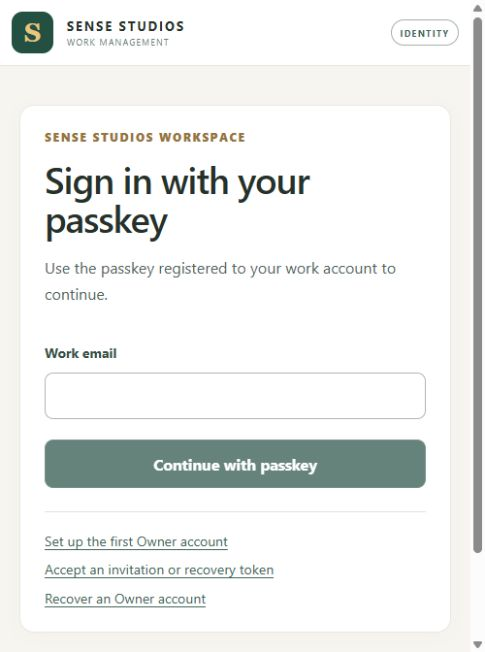

# Working server and final helper-only completion — 13 October 2026

## Subsequent authorized completion — PASS

Owner approved one renewed helper completion after the scope fix. The repeated live guards passed, verified ownership metadata was published, and helper 31280 launched once. All five actual STAFF sessions and ten exact tasks each passed with scoped role isolation. Post-helper identity/Owner/task/catalog preservation passed. Designer 1 activation through the real controller succeeded once and its screenshot is retained. No PG/API/web lifecycle operation occurred in this completion. Working services/data remain retained. See [the recovery result](TEST_SERVER_RECOVERY_RESULT_2026-10-13.md) for the active server/controller links and exact evidence; the preparation and stopped-attempt history below remains preserved.

## Subsequent single attempt and verified correction

The approved helper-only attempt stopped before directory creation, metadata publication, helper launch or authentication. Exact cause: dot-sourcing the shared preflight imports its typed `$Live` switch; the new completion script assigned a process array to case-insensitive `$live`. This operator error was corrected with `$completionLiveMatches`, not a changed guard.

Two inert scope cases reproduce the collision and verify the distinct collection variable. **162/162 offline cases and31/31 parser files PASS.** The complete actual preflight was then executed in explicit `-InspectOnly` mode at11:35:15IST: **PASS**, zero writes/launches/authentication, exact live4process identities, canonical manifest, listeners/readiness, preview/50tasks/Owner/catalog and prior-helper absence. Evidence: `evidence/test-switcher-activation-20261012/helper-full-live-readonly-preflight-20261013.json`.

`-InspectOnly` cannot be combined with `-Execute` and returns before every write/launch. Independent Sol reviewed the corrected control flow. The stopped attempt's logs remain intact. A renewed single helper-only approval is requested under the Owner stop-on-failure condition; future supervisor logs use a fresh scope-fix suffix. No PG/API/web lifecycle operation is included.

## Actual result

The no-start continuation launched API18408 and web16368 exactly once. Its web readiness deadline expired, so the remaining metadata/helper stages stopped. Subsequent read-only checks found API, web root and API proxy all HTTP200; the live Codex browser displays the normal sign-in page. No server restart or helper launch occurred.

Working link: [http://localhost:59223/](http://localhost:59223/).
Owner signs in normally as `owner@local.test`. Owner My Work remains0personal without employee identity; the existing50staff tasks are available through authorized Tasks.

PG38768/system7693570241708228348/45434/previewOID32768/115migrations and all50exact task IDs (10each/5staff), Owner credentials/recovery and other catalog passed live read-only preservation checks. Both blocked supervisors and PG parentCMD11788 remain retained; no unrelated process was touched.

Actual public page:


## Proposed remaining action

The stop-on-failure condition ended the continuation. One fresh helper-only authorization is required. **No PG/API/web start, stop or restart** is proposed.

Prepared `.env.checkpoint-tools/test-personas/complete-helper.ps1`:
1. Require Windows Medium/pinned Node24.19.0/pnpm11.19.0/PS7, already-running exact PG and known PG38768/API18408/web16368/supervisor35168 owner/executable/command/parent/creation identities.
2. Verify public readiness, exact preview/OID/115/50task IDs/5staff/Owner/catalog, prior encrypted state/preservation, helper35632 absent and no competing helper.
3. Add the previously absent immutable owned-process manifest to the existing CF server run; preserve historical attempt/blocked artifacts. Snapshot old latest pointer and publish the verified current pointer once.
4. Run the full host guard, then launch existing `operator.mjs launch` ONCE. Normally sign in the5existing synthetic staff with their approved stored software test passkeys; preserve role-isolation and10exact tasks each.
5. Require an atomic readiness record containing actual verified persona totals. Buffered stdout is diagnostic evidence only. Recheck helper process and preservation, then exercise Designer1 once through the real test controller.
6. Leave working services/records retained. Any failed guard stops; no automatic retry, reset, deletion, migration, new database, reseed, production/app/security change or Owner credential automation.

Readiness publication is atomic and occurs only after existing session/task/permission/environment assertions pass. No assertions were removed. Offline **160/160 cases,30/30 parser files**, default no-Execute mode PREPARED; independent Sol source review found no material blocker. Native-output regression remains PASS. No authenticated helper tests have yet run.

Infrastructure-only preparation: `complete-helper.ps1`, `complete-helper.test.mjs`, `verify-offline.ps1`, and `operator.mjs` readiness metadata. Frontend/backend functionality unchanged; prior accepted evidence and baseline debt preserved.

## Exact command after approval

```powershell
$helperPs = 'C:/Users/HI/.cache/codex-runtimes/codex-primary-runtime/dependencies/native/powershell/pwsh.exe'
$helperArgs = '-NoLogo -NoProfile -File "D:/app/sensestudios work management app/.env.checkpoint-tools/test-personas/complete-helper.ps1" -Execute'
Start-Process -FilePath $helperPs -ArgumentList $helperArgs -WorkingDirectory 'D:/app/sensestudios work management app' -WindowStyle Hidden -PassThru
```

One new helper-completion evidence directory:
`.env.checkpoint-tools/runs/helper-completion-73cfb9f7-2c20-4508-b957-06f8d7461d20`.
The unique supervisor logs and reviewed source hash bundle are retained. Risks are normal local STAFF session/passkey-counter/audit updates only. No full MW-I02 acceptance run, completion claim or MW-I03.

