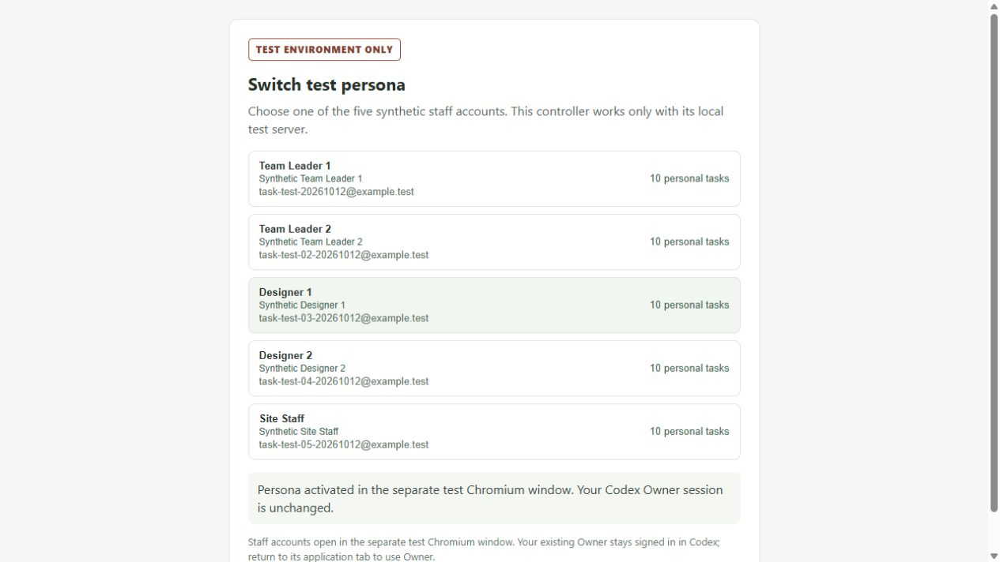

# Retained test server and persona switcher — 13 October 2026

## Result

**PASS for the authorized test-server/helper recovery.** The renewed helper-only completion launched the existing helper once. It started no PostgreSQL, API or web process. All five retained synthetic staff signed in normally using the previously approved software test passkeys. Designer 1 activation was then exercised once through the real controller and returned success.

- Application: [Test server](http://localhost:59223/)
- Controller: [Test user switcher](http://127.0.0.1:57753/MzYZ5li34slIyqNByPG9BQueVve-nzD5)
- Owner: normal `owner@local.test` passkey sign-in in Codex.

The switcher activates the separate managed test Chromium staff window. It does not replace the Codex Owner session. The controller is test infrastructure, not a production application feature. The old controller on port 64582 is no longer valid.

## Accounts and actual verification

| Persona | Account | Exact personal tasks |
| --- | --- | ---: |
| Team Leader 1 | task-test-20261012@example.test | 10 |
| Team Leader 2 | task-test-02-20261012@example.test | 10 |
| Designer 1 | task-test-03-20261012@example.test | 10 |
| Designer 2 | task-test-04-20261012@example.test | 10 |
| Site Staff | task-test-05-20261012@example.test | 10 |

The helper checks actual STAFF session identity, each employee ID, exact stored task-ID sets and total 10, with assignment enabled only for the two Leaders. Designer 1 access to Designer 2's personal task returned 403; Leader 1 access to the unrelated project task returned 403. The original two projects and review/correction fixtures remain retained. Owner has no employee identity, so zero personal My Work tasks remains truthful; the staff fixtures are available through authorized organization Tasks.

The controller showed: “Persona activated in the separate test Chromium window. Your Codex Owner session is unchanged.” This is controller activation evidence, not a new full My Work visual acceptance capture.

## Environment and preservation evidence

The completed live guards verified Windows Medium context and pinned Node 24.19.0/pnpm 11.19.0, PostgreSQL system `7693570241708228348`, exact retained directory, endpoint `127.0.0.1:45434`, preview database `sense_local_preview_20261008_1791474390772_test`, OID 32768 and 115 existing migrations. Process identities were PG 38768, API 18408, web 16368 and application supervisor 35168; the new helper is 31280.

Post-helper read-only preservation PASS at `2026-10-13T06:12:23.190Z` (11:42:23 IST): all 50 exact task IDs, five employees, two projects, role/grant counts, zero overrides, Owner credentials/recovery/zero employee identity and all other database catalog entries unchanged. The prior backup and source environment hash matched. No database was created, reseeded, migrated or deleted during this completion. Working services and records are retained for Owner testing.

Authoritative run evidence:

- `.env.checkpoint-tools/runs/helper-completion-73cfb9f7-2c20-4508-b957-06f8d7461d20/result.json`
- Same directory: `before-helper.json`, `full-host-identity.json`, `helper-process.json`, `after-helper.json` and preserved supervisor logs.
- `evidence/test-switcher-activation-20261012/helper-full-live-readonly-preflight-20261013.json`
- `evidence/test-switcher-activation-20261012/helper-scope-fixed-source-hashes-20261013.json`
- `evidence/test-switcher-activation-20261012/designer1-activation-result-20261013.json`

Earlier stopped attempts remain separately preserved. Ordinary PostgreSQL recovery and one API/web launch occurred under the earlier explicit recovery approvals; this final completion performed only the approved metadata publication, one helper launch, normal staff sign-ins and one Designer 1 activation. No application functionality or security settings changed.

## Checks and acceptance boundary

Preparation: 162/162 offline infrastructure cases and 31/31 parser files passed; the complete actual read-only preflight passed before the renewed execution. These are infrastructure checks, not frontend test results. Prior 130/130 affected frontend checks, typecheck/lint/build and the 20 tracked full-suite baseline failures remain preserved; the frontend suite was not rerun during recovery.

GPT-6.1 Sol independently reviewed the recovery source and saved completion/preservation evidence. The bounded manifest implementation used GPT-6 Luna; neither routing claim changes the primary chat's model.

This result restores the retained testing environment. It is not a full MW-I02 authenticated acceptance run or prototype-fidelity acceptance. MW-I02 remains **IN PROGRESS**; the exact Needs action/Reviews backend-filter plan and current-source final visual acceptance remain pending. MW-I03 was not started.
