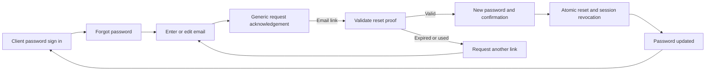

# Login flows by user type — Sense Studios

Date: 17 October 2026  
Status: planning deliverable; no implementation or acceptance claim.  
Priority: **plan and settle these login journeys first**, before broader application UI changes.

Owner direction: “first plan login flows for all users sapparately.” Retain the earlier selection **“Propose client passwords.”** This document becomes the first-stage login specification for the [broader UX/UI plan](UX_UI_FLOW_IMPROVEMENT_PLAN_2026-10-17.md).

## 1. Decisions carried forward

- Owner and internal staff use registered passkeys. Lost staff passkeys require Owner verification/authorization; Owner recovery uses the existing offline code.
- Clients receive the proposed email/password login, first-password setup and forgot/reset flow. Retain the current email-code option as the proposed alternative/migration bridge.
- Consultants, Vendors and Factory/Production users retain emailed-code login; the client password proposal does not change their authentication.
- Formal client approval remains a separate registered-passkey step-up bound to the exact action, item/revision or final batch.
- Login identifies the account; backend membership, assignments, grants and resource state determine access. A page title, selected role or route never grants authority.
- Every user type below gets a separate documented journey. Shared authentication components remain shared; no second role, account or permission system is introduced.

Approved source: current Owner direction; R-005/R-006–R-009/R-075/R-076/R-092/R-099; C-008 and C-013–C-016/C-023/C-024; S02/S14/S21 specifications; current identity services and route callers. Current C-008 selects passkeys and external codes. Client passwords remain a proposed narrow method change, not an implemented amendment.

## 2. User-by-user overview

| User type | Sign-in method | First-time access | After successful sign-in | Recovery |
| --- | --- | --- | --- | --- |
| Owner | Passkey | Controlled bootstrap → first passkey → second distinct passkey → acknowledged offline recovery code | Finish required Owner setup, otherwise Dashboard or an authorized requested destination | Other registered passkey; existing offline-code recovery |
| Team Leader | Staff passkey | Owner invitation → passkey enrollment; current membership/grants configured separately | Dashboard → permitted team work/decisions | Owner-verified staff recovery |
| Project Lead | Staff passkey | Ordinary staff enrollment plus explicit project appointment/grants | Dashboard or authorized project deep link | Owner-verified staff recovery |
| Employee | Staff passkey | Owner invitation → passkey enrollment | Dashboard → My Work / assigned tasks | Owner-verified staff recovery |
| Site Employee | Staff passkey | Ordinary staff enrollment plus explicit site/project assignment | Dashboard or authorized site/task deep link | Owner-verified staff recovery |
| Reviewer | Staff passkey | Ordinary staff enrollment plus current named review assignment | Dashboard or authorized exact review link | Owner-verified staff recovery |
| Part-time employee | Staff passkey | Ordinary staff enrollment with explicit membership/assignments | Dashboard → own permitted work/time | Owner-verified staff recovery |
| Intern | Staff passkey | Ordinary staff enrollment with explicit membership/grants | Dashboard → own permitted tasks/training | Owner-verified staff recovery |
| Primary Client | Proposed password; existing email code alternative | Owner appoints Primary and grants access → prove invited identity → set password | Client project list/overview or valid review destination | Client forgot/reset password; mailbox loss needs separately reviewed verified help |
| Additional Client | Proposed password; existing email code alternative | Primary invitation and exact scope → prove identity → set password | Only shared projects/items; item approval only if delegated | Same client reset flow; reset never expands delegation |
| Consultant | Emailed one-time code | Authorized staff invitation and exact consultant grants | Consultant project/document workspace or valid scoped destination | Request another code; mailbox/access problems → authorized studio contact |
| Vendor | Emailed one-time code | Authorized staff invitation and exact vendor/work-package grants | Vendor drawings/requirements/acknowledgements/advisory updates | Request another code; no password reset |
| Factory/Production user | Emailed one-time code | Authorized staff invitation and exact production grants | Production requirements/packages/acknowledgements/advisory updates | Request another code; no password reset |
| Public visitor | None | No account required | Explicitly published portfolio only | Not applicable |

Project Lead is an appointment within internal Staff, not another AccountKind. Reviewer/site/part-time/intern labels also do not automatically confer permissions. Vendor and Factory have separate audience journeys here but currently share the `VENDOR_FACTORY` grant type. Do not invent a new factory identity/grant type.

Internal ordinary landing remains **Dashboard**, as previously directed. Role-related next actions are useful links/content within current access, not new automatic landing policy. Existing task/project/review deep links take priority only after authorization.

## 3. Entry pages and route plan

Proposed public hub: **“Sign in to Sense Studios”** with:
- Studio team — “Owner and employees”
- Clients — “Your projects, drawings and reviews”
- Consultants — “Shared documents and project requests”
- Vendors and production — “Drawings, requirements and updates”
- View public portfolio — ordinary public link, not account creation

Studio team may expose a compact **Owner sign in** link alongside the ordinary team form. Do not show separate public buttons for every staff job title; those titles are not authentication choices.

All addresses below are **proposed frontend routes**. Reuse the existing APIs and keep old entry/enrollment URLs compatible.

| Proposed route | Intended screen / compatibility |
| --- | --- |
| `/sign-in` | Public sign-in chooser; current `/` signed-out behavior may link or alias here without changing signed-in Dashboard/deep-link routing |
| `/owner/sign-in` | Owner-labelled passkey form, Owner recovery and first-setup help |
| `/staff/sign-in` | Shared passkey form for all internal staff types; enrollment and “Can't sign in?” |
| `/staff/recovery` | Recovery guidance and existing token-enrollment link; no self-issued recovery credential |
| `/bootstrap`, `/enroll`, `/owner-recovery` | Preserve existing controlled setup/enrollment/Owner-recovery routes |
| `/client-portal/login` | Client password form plus email-code alternative, password setup and recovery links |
| `/client-portal/activate` | Proven invited client identity → first-password setup |
| `/client-portal/forgot-password`, `/client-portal/reset-password` | Client recovery request, reset and durable completion/error screens |
| `/external-portal/consultant/login` | Consultant-labelled email-code form |
| `/external-portal/vendor/login` | Vendor-labelled email-code form |
| `/external-portal/factory/login` | Factory/Production-labelled email-code form; may be linked from the same Vendor/production entry |
| `/client-portal/*`, `/external-portal/*` | Preserve existing portal links; add real nested route handling rather than silently rendering the same page for every path |
| `/portfolio` | Existing anonymous published-content destination |

For Vendor/Factory, keep one entry with clear audience wording; dedicated aliases can provide appropriate invitation copy without duplicating forms. Likewise, consultant/vendor/factory login URLs express intended context; after verification the server-returned grants decide whether that context exists. If the account has multiple permitted external contexts, show a chooser of those returned contexts only.

Keep the actual identity/session separation:
- OWNER and STAFF: existing internal identity API/session.
- CLIENT: existing isolated client identity API/session, extended with proposed password actions.
- EXTERNAL: existing isolated external identity API/session and exact portal-type grants.
- Anonymous: public portfolio only.

An Owner using the Staff URL remains an Owner because the authenticated account says so; a Staff user using an Owner-labelled URL acquires no Owner rights. Offer the correct signed-in destination after proof, without disclosing account kind before authentication.

## 4. Owner flow

**Normal:** Owner sign in → work email → Continue with passkey → browser/device verification → server identity/session validation → required setup check → Dashboard or authorized destination.

**First Owner setup:**
1. Deployment operator supplies the controlled initial setup details through the approved secret process.
2. Owner opens existing bootstrap, enters email/setup secret and registers the first passkey.
3. Show setup progress: first passkey registered; second distinct passkey required; offline recovery kit required.
4. Register the second distinct passkey, generate the one-use recovery code, store it offline and explicitly acknowledge storage.
5. Only after the existing setup requirements pass, continue into ordinary Owner administration.

**Can't sign in:** explain use of another registered passkey; otherwise open offline-code recovery → email/code validation → replacement passkey ceremony → existing credential/session invalidation and renewed setup requirements → Dashboard when ready. Never present a password-reset form to the Owner.

If all Owner passkeys and the offline code are unavailable, show honest operator/support guidance. No new self-service bypass is proposed.

**Screens/states:** passkey form; waiting for device; cancellation; unsupported browser; generic invalid attempt; throttled/network failure; setup checklist; recovery form; replacement ceremony; setup complete. Keep first-Owner bootstrap secondary and technically controlled; do not remove its route.

## 5. Team Leader flow

**Normal:** Studio team sign in → work email → passkey verification → current STAFF session and membership/grants → Dashboard → permitted team attention/Decisions/Projects.

**First time:** Owner invitation token → existing enrollment proof → register passkey → activated identity → normal sign-in/restore → check employee configuration and current grants. Title alone never enables team management; existing directory/self/reporting rules remain.

**Recovery:** Can't sign in → instructions to contact Owner → Owner verifies out of band and records reason → existing staff recovery revokes lost credentials/sessions and issues replacement proof → existing enrollment ceremony → ordinary access re-evaluation.

**Key state:** no current management grant or reporting relationship means ordinary permitted staff content, not a team-wide dashboard or a role-picker fix.

## 6. Project Lead flow

**Normal:** Studio team sign in → passkey → STAFF session → current project assignment/appointment check → authorized project deep link, otherwise Dashboard → assigned project.

**First time:** existing staff enrollment; Project Lead appointment is separate from authentication. Signing in does not appoint a lead or grant cross-branch access.

**Recovery:** existing Owner-verified staff recovery. Preserve only safe same-account return context through reauthentication, then recheck project access.

**Key states:** appointment changed, project On Hold, no assignment, cancelled/expired context or guessed project ID. Show a truthful unavailable/denied state and a safe return; do not restore authority from a bookmarked page.

## 7. Employee flow

**Normal:** Studio team sign in → email/passkey → current employee/session validation → Dashboard → My Work or assigned task.

**First time:** Owner invitation → one-time enrollment token → passkey registration → current employee membership check. If membership is not configured, show “Your account is set up; contact the Owner to finish workspace access,” without fabricating projects or permissions.

**Recovery:** Owner-verified replacement flow; no email-only credential reset.

**Key states:** passkey cancelled; unsupported device; suspended/exited account; assignment removed; no work currently assigned. Suspension/exit deny current access according to existing lifecycle rules.

## 8. Site Employee flow

**Normal:** Studio team sign in on phone/desktop → passkey → current STAFF/project/site permissions → authorized site/task deep link, otherwise Dashboard → Site delivery.

**First time:** standard staff enrollment and explicit site/project assignment. The SITE presentation variant does not identify an active site or restrict task types by itself.

**Recovery:** standard Owner-verified staff recovery; unsupported browser/device guidance must not promise an unverified QR/phone handoff.

**Offline:** explain that a new online sign-in cannot complete offline. Preserve only already authorized, account-bound supported offline queues under the existing PWA rules. Reconnection must reauthenticate/reauthorize before sync; no cross-account queue display.

## 9. Reviewer flow

**Normal:** exact review link → sign in with staff passkey when required → current named review/file authorization → exact current review, otherwise safe Dashboard/denied state.

**First time:** ordinary staff enrollment plus named review assignment. Selecting “Reviewer” is never an authentication step or grant.

**Recovery:** standard Owner-verified staff recovery.

**Key states:** round withdrawn, superseded evidence, reviewer reassigned, file scope revoked or stale version. Do not automatically start/approve a review simply because login succeeded; preserve ordinary explicit review commands.

## 10. Part-time employee flow

**Normal:** Studio team sign in → passkey → active identity/membership/grants → Dashboard → own assigned tasks and authorized time/learning.

**First time:** standard invited staff enrollment. Employment schedule/type does not create another login method, global directory, timer permission or access window.

**Recovery:** standard Owner-verified staff recovery.

**Key states:** no employee setup, no assignments, current suspension/exit, offline or expired session. Use existing policies; do not infer shift-based login restrictions.

## 11. Intern flow

**Normal:** Studio team sign in → passkey → current identity/membership/grants → Dashboard → permitted assigned tasks/training.

**First time:** standard staff invitation/enrollment and explicit assignment. Intern status is not itself a complete permission bundle.

**Recovery:** standard Owner-verified staff recovery.

**Key states:** unconfigured membership, restricted resource, missing training/task assignment, supervisor/reporting change. Do not grant broad employee, client or project browsing merely to simplify onboarding.

## 12. Primary Client flow

**First time:** Owner appoints Primary and grants project access → invitation/proven email identity → proposed password setup → ordinary client sign-in → authorized project chooser/overview. The invitation/proof must remain bound to the existing CLIENT account; it does not create a second identity.

**Returning:** Client sign in → email/password → server validates current CLIENT eligibility → fresh isolated client session → valid requested review/file destination; otherwise one project opens its overview or multiple projects show a chooser.

**Email alternative:** Email me a code → generic acknowledgement → code entry with editable email/resend/help → current eligibility/code validation → same isolated client landing.

**Formal approval:** open exact item/batch → review evidence and authority → register/use passkey as permitted → exact action-bound step-up → explicit canonical approval → receipt. Password login alone cannot approve or issue a drawing.

**Forgot password:** client recovery sequence in section14. Lost mailbox or lost approval passkey is a separate verified-help problem; resetting a password must not silently replace approval authenticators.

**Key states:** password not set, bad credentials, expired/used reset proof, no currently usable grant, cancelled read-only project with per-client expiry, revoked Primary authority and stale approval round.

## 13. Additional Client flow

**First time:** Primary invitation plus exact project/item rights → prove invited identity → proposed password setup → ordinary Client sign in → only shared project/item workspace.

**Returning:** same client password/code forms as Primary → server identifies exact current grants → shared project chooser or authorized requested item.

**Recovery:** same client forgot/reset sequence, preserving account ID, item scope and evidence. Recovery cannot create Primary status or renew expired invitations/delegations.

**Approval:** view/comment/review as granted; formal item approval only for currently delegated exact items and registered-passkey step-up. Final overall approval stays with the Primary.

**Key states:** invitation withdrawn, delegate rights changed, item no longer shared, cancellation read-only, grant expired. Do not expose Primary-only controls or internal records.

## 14. Client forgot/reset password flow

Applies to **Primary and Additional Clients only** under the proposed password method.

- Keep email editable; do not reveal whether an account exists, is a Primary/Additional Client or has a password.
- Give a durable confirmation, resend/change-email/back actions and honest mail-outage help. “Request accepted” is not “delivered.”
- Loading/opening a reset link does not consume it. Validate purpose, account, expiry and replay at submission.
- Support password managers, paste, Show password and matching confirmation. Follow one reviewed policy for setup, reset and change.
- On completed reset: update password/version, consume/invalidate recovery proofs, revoke CLIENT sessions and dependent in-flight ceremonies, retain nonsecret security evidence and send the approved reset notice. Return to ordinary sign-in.
- Do not alter project grants, Primary/delegated authority, approval passkeys or historical signatures.
- Full proposed backend/migration/security requirements and unapproved policy values remain in sections6/7/9 of the broader UX plan; this document does not silently settle them.

## 15. Consultant flow

**First time:** Owner, current assigned Project Lead or explicitly authorized Team Leader creates the exact consultant invitation/grants through the ordinary authorized workflow.

**Sign in:** Consultant entry → email → Send code → generic acknowledgement → single pasteable six-digit code → server validates active EXTERNAL account/current grant/code → consultant-scoped project chooser or valid requested document.

**Recovery:** resend/correct email within existing limits; if mailbox is unavailable or access has ended, contact the authorized studio manager. No “Forgot password?” and no arbitrary email/account change.

**Key states:** wrong/expired/used code, send/attempt limit, delayed mail, no current consultant grant, scope revoked. Held/completed project history and cancelled-project closeout follow S21, not a generic portal bypass.

Consultant comments/reviews/uploads are advisory. Only existing authorities finalize work. CAD access remains the Owner-controlled exact native-share workflow.

## 16. Vendor flow

**First time:** authorized studio manager issues exact project/drawing/release/work-package grants; no self-registration.

**Sign in:** Vendor entry → email → request code → generic acknowledgement → verify code → active EXTERNAL session → permitted Vendor project/work-package context.

**Recovery:** request another code or contact the authorized studio manager for verified access/mailbox issues.

**Landing:** granted drawings, operational requirements/deadlines, requests, own-recipient acknowledgements and advisory updates. Do not expose employee data, unrestricted files, protected internal prices or procurement/client-approval authority.

**Key states:** wrong persona destination, grant expiry/revocation, withdrawn package, held/completed delivery and cancelled project. Only a distinct valid closeout grant permits bounded closeout access.

## 17. Factory/Production user flow

**First time:** authorized studio manager issues exact production release/package/resource grants under the existing `VENDOR_FACTORY` type.

**Sign in:** Factory/Production-labelled entry → email → request/verify code → EXTERNAL session → currently granted production context.

**Recovery:** code resend or verified studio help, not password reset.

**Landing:** granted production requirements/material quantities/drawings/deadlines, relevant uploads and acknowledgements, advisory production-status submissions. Authentication never finalizes production progress or changes approved inputs.

**Key states:** superseded/withdrawn source, ungranted production release, expired/revoked access, cancelled delivery. Separate closeout evidence and native CAD rules remain enforced.

Vendor and Factory share authentication and the current grant type. Different headings/links explain the audience; distinct access comes from exact returned grants/resources, not a new user-selected type.

## 18. Public visitor flow

**Browse:** open existing public portfolio → explicitly published presentation content → optional sign-in chooser if seeking a restricted workspace.

No account, password, OTP or forced login is needed for public content. A private project/file URL never becomes public because it was reached from the portfolio. Withdrawn/unpublished/private items remain unavailable.

## 19. Shared login behavior and state contract

Every auth form uses the existing Sense Studios visual direction, a narrow readable column, one clear primary action, labelled fields, inline/status feedback and an obvious “Back to sign-in options.”

| State | UI behavior |
| --- | --- |
| Restoring an existing session | Show checking state; no flash of another account's content; distinguish no session from failed session service |
| Ready / submitting | Keep destination/audience clear; prevent duplicate submission; preserve safe email context |
| Passkey waiting / cancelled / unsupported | Say what happened and how to retry/use an already registered device; do not add a password fallback for staff |
| Invalid password/code/proof | Safe generic feedback; allow appropriate retry; no identity/project disclosure |
| Code requested | Show the address the user entered, editable-email action, code field and allowed resend/help; no claim the address exists |
| Rate limited / mail delayed / network or service failure | Explain retry/help without discarding safe context or promising delivery |
| Authenticated but not configured | Honest internal setup guidance or currently unavailable portal context; never fabricate grants |
| Revoked / suspended / expired | Clear protected data; stop protected commands; return to correct identity's sign-in/recovery |
| Session ended while editing | Preserve only an allowed same-account safe draft; reauthenticate, reauthorize and require explicit command retry |
| Wrong portal / multiple external contexts | Use verified identity and current server-returned grants; offer permitted destinations; no role switching into authority |
| Logout pending / success / failed | Revoke correct identity session, clear correct account's private UI/cache, confirm success only after actual result |
| Offline | New sign-in requires connection; current approved internal offline behavior remains separately bounded |

Return destinations must be same-origin and allowlisted, with current resource authorization after login. An email, raw role parameter or arbitrary return URL never grants access. Do not log/store credential, OTP or recovery secrets in browser preferences, analytics or PWA caches.

An existing internal, CLIENT or EXTERNAL cookie cannot be exchanged for a different identity kind. Do not automatically terminate another portal's session merely to enter this one; make explicit account change/sign-out scoped and understandable.

Current Account storage makes normalized email globally unique and records one AccountKind. This plan does not assume the same email can create parallel Staff/Client/External identities. Multiple staff duties or external project/persona grants can use the existing identity model; any cross-kind same-person/email requirement needs a separate reviewed identity contract rather than an improvised role switch.

## 20. Refero evidence and design direction

**Curated UI shortlist:** [LOGIN_UI_REFERENCES_REFERO_2026-10-17.md](LOGIN_UI_REFERENCES_REFERO_2026-10-17.md) shows six inspected references with previews, exact audience mapping and bounded adaptations: Family passkey/recovery, Mercury client password form, Cal.com recovery request, Dock email code and Dropbox security/sessions. This is the proposed LOGIN-02 reference set; no final mockup or implementation is claimed.

Reuse the prior [research evidence](UX_UI_FLOW_REFERO_EVIDENCE_2026-10-17.json) and existing approved brand lock. Seven earlier style searches returned no results; no new style system is claimed. This follow-up is journey planning rather than visual redesign.

- [Contra email-code flow](https://refero.design/flows/4815), newly retrieved in full: email → clear code stage → invalid-code correction/resend → authenticated dashboard. Adapt its sequence and recovery clarity. Retain our single pasteable code field; do not copy segmented focus jumping, social login, rewards or unrelated dashboard features.
- [Reown sign-in screen](https://refero.design/pages/250d498d-1f2c-431f-afed-9e58421f24d2), newly retrieved in full: focused email/password form and adjacent recovery link, applicable to proposed client passwords only. This is a password screen, not evidence for staff passkey behavior. Do not import Google login or its palette.
- [Reown reset flow](https://refero.design/flows/5727) and [Voicenotes confirmation](https://refero.design/pages/eae29959-ed62-4641-934f-7ba59c33dc52), previously inspected: clear recovery entry, durable generic acknowledgement and return to sign-in.
- Owner setup, staff passkey recovery and permission isolation come from approved S02/C-008 sources and existing code, not an unrelated consumer flow.
- New passkey/invitation flow searches mostly returned password, enrollment, community or invitation-management examples. They were not treated as evidence of a directly matching passkey/staff recovery journey.

Supplemental reference records are saved in [LOGIN_FLOWS_REFERO_EVIDENCE_2026-10-17.json](LOGIN_FLOWS_REFERO_EVIDENCE_2026-10-17.json). No external account operation or email was performed.

## 21. First-stage deliverables, dependencies and acceptance

| Stage | In scope | Dependencies and acceptance |
| --- | --- | --- |
| LOGIN-01 Journey separation | This user-type matrix; individual first-time/returning/recovery journeys; route and state inventory | R-005.a–d/R-007/C-008; verify all14 audiences above and preserve existing methods except the explicit client proposal |
| LOGIN-02 Auth screen specification | Entry chooser; Owner/team forms; setup/recovery; client password/activation/reset; consultant/vendor/factory code screens | Existing design tokens, auth APIs and approved identity boundaries; click-through at1440/1024/390/320 including keyboard/mobile input and error states before broader UI work |
| LOGIN-03 Identity/API specification | Client-only credential/schema/migration/policy; precise setup/reset contracts and race/session behavior | R-076/R-099, S02/S14 and existing IDN/PORT; resolve material unspecific decisions in a reviewable contract before implementation; no assumed database lifecycle permission |
| LOGIN-04 Bounded implementation | Existing-system entry/route integration and client password vertical slice; external audience labels/landing composition | LOGIN-02/03; reuse current services and explicit frontend nested routing, no new roles/grants or rewritten external authentication |
| LOGIN-05 Verification | Actual login/enrollment/recovery/return/logout and current-grant behavior | Existing dedicated approved harnesses; source-bound checks, real persistence and responsive visual review; broader app work follows the settled login baseline |

These stages refine UXF-01/02 and the authentication part of UXF-03. They do not restart previously accepted V1 work or authorize a stopped MW-I02 retry. The observed current-development My Work JSX overlay remains a separate baseline finding, not a reason to redesign authentication.

Required checks when implemented:
- OWNER setup gating, second passkey/offline code and legitimate recovery; no public Owner bootstrap bypass.
- Every STAFF audience signs in through the same real passkey boundary; role/membership/assignment/branch changes alter access immediately without reissuing a user-selected role.
- CLIENT setup/login/code alternative/reset; Primary versus Additional versus delegated exact approval; password reset cannot act as approval step-up or recreate grants.
- EXTERNAL consultant versus vendor/factory exact grant/resource isolation; no password fallback or internal/client cookie interchange.
- Unknown/inactive/ungranted accounts receive privacy-preserving public responses; code/proof replay, expiry, concurrency and brute-force controls are exercised.
- Cross-portal/open-redirect/guessed-ID attempts fail; revoked sessions/private caches and account-bound offline queues clear correctly.
- Existing links/bookmarks/invites/deep links survive; current setup and cancelled-project restrictions are checked before landing.
- Real desktop/mobile passkey and mail behavior are tested where required; virtual authenticators and mocked mail are identified as such.
- Pinned Node24.19.0/pnpm11.19.0 affected checks then full current-source `pnpm verify`, using only appropriately authorized dedicated test targets.

This plan does not schedule deployments, create accounts, request codes, change credentials, migrate/reseed data or run tests. Numeric client password/reset policies remain proposed in the broader plan; no new employment, access-duration or mail-delivery policy is invented here.

## 22. Session record and limits

Prepared by the current Codex agent; no independent Opus/Sonnet or final security acceptance review is claimed. Source-grounded planning and Refero retrieval were performed. No application/schema/runtime/database change, browser login, email request, deployment or feature test was performed in this follow-up.

Document verification exited0: all14 named audiences have individual flow sections; all five LOGIN stages are present; supplemental JSON parses with one full flow/one full screen and reference URLs; local links in this plan and the updated broader plan resolve. Those checks are document verification only. All actual operational R-104/R-105, production and current-candidate acceptance limits remain unchanged.

