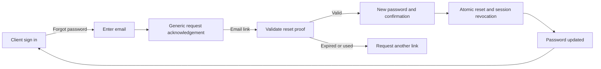

# UX/UI flow improvement plan — Sense Studios

Date: 17 October 2026  
Status: PLAN COMPLETE; implementation not started by this task.  
Owner direction: improve the application's UX/UI using Refero MCP; include forgot password and client login. The Owner selected **“Propose client passwords”** when asked about the client sign-in method. This confirms the planning direction; proposed policy values below are not recorded as approved defaults.

**Updated priority:** the Owner subsequently directed login flows for every user type to be planned separately first. [LOGIN_FLOWS_BY_USER_2026-10-17.md](LOGIN_FLOWS_BY_USER_2026-10-17.md) is now the first-stage login specification:14 separate audience journeys, first-time access, returning sign-in, recovery, current-grant landing and shared states. LOGIN-01–05 refine UXF-01/02 and the authentication portion of UXF-03 before broader UI work. Internal passkeys and EXTERNAL email codes remain unchanged methods; the earlier client-password proposal is retained. No implementation is started by that priority change.

## 1. Recommended outcome and boundaries

Make the application explain **where I am, what needs action, and what happens next**. Improve the real application incrementally, reusing its persistence, permissions, canonical commands and existing V1 delivery.

Priorities:
1. Establish a stable current-source baseline and resolve the observed My Work compile blocker.
2. Create clear Staff / Client sign-in entry points and recovery journeys.
3. Deliver client email/password login, password setup and forgot/reset password, together with a project-first client portal.
4. Refine the internal shell, Dashboard, My Work, Tasks, Projects, People and Settings against the same visual/interaction rules.
5. Validate real persisted journeys, accessibility and four responsive widths on the accepted current candidate.

This is an extension of `docs/development/V1_INTERNAL_PILOT_PLAN_2026-10-15.md` and `PLAN_V1_WORKING_VERSION.md`, not a replacement or restart. Agent1 D/G/E/H delivery and its bounded acceptance remain preserved. Static `docs/design/_build` prototypes remain layout references; they do not establish authorization or persistence.

In scope: navigation/discovery, hierarchy and density, task/project continuity, forms, recovery/error states, mobile ergonomics, client credentials and recovery, client portal information architecture, acceptance and rollout planning.

Out of scope: staff password authentication, public client registration, consultant/vendor authentication changes, new organization tiers, permission expansion, new approval authority, rewritten domain state machines/calculations, cross-device saved views, global document search, new messaging providers, AI inference, production deployment or retained-database lifecycle operations.

Actual operational R-104/R-105 acceptance and production readiness remain unverified. S18/S27 historical local completion is retained within its recorded source boundary; it is not current-tree acceptance.

## 2. What the current app establishes

| Finding | Evidence inspected this session | Consequence for the plan |
| --- | --- | --- |
| Staff sign in with passkeys; links cover setup, enrollment/recovery token, Owner recovery and phone installation. There is no Client login link in that form. | `apps/web/src/app.tsx`, Login and its identity links; source inspection | Add a visible Client sign-in choice and a plain-language “Can't sign in?” path. Keep staff passkeys and existing verified recovery. |
| Client login already exists at `/client-portal/*` and requests emailed codes. | `main.tsx`, `client-portal-auth.tsx`, client identity service/controller; live client sign-in inspected | Extend existing CLIENT identity/session infrastructure with password credentials; avoid a second account system. |
| Client business content is initially hidden behind Open dashboard / Open reviews / View approved costs buttons; account security leads the signed-in page. | `client-portal-auth.tsx`; source inspection, not an authenticated client walkthrough | Make authorized project work the default landing surface; move security and sessions into Account. |
| Dashboard exposes a long Work navigation group, substantial repeated page chrome, raw status keys and long attention lists. | Live Owner Dashboard accessibility tree and screenshot at the browser's existing desktop size | Tighten hierarchy, humanize status labels and bound visible previews. Preserve true source counts, freshness and independent failures. |
| Opening My Work produced a Vite JSX parse overlay: “Adjacent JSX elements must be wrapped in an enclosing tag,” pointing at `apps/web/src/task.tsx:926:126`. | Read-only live navigation during this planning session | Record as an observed current-development blocker. Reproduce against stable source before fixing; concurrent edits were present. This session did not diagnose or repair it. |
| People, task composer, task detail, project resources, bounded queries and local saved views already have V1 work. | Current state/status, V1 plans and relevant callers | Reuse and verify that work. Do not replace it with prototype behavior or introduce parallel components. |
| Historical Refero lock and current theme contain different exact palette values. | `UX_REFERO_DESIGN_LOCK_2026-10-08.md` versus `studio-theme.css` | Keep the current theme as the proposed implementation token source and record reconciliation before styling; do not introduce another palette. |

Live inspection was limited to the Owner Dashboard, client signed-out entry and the failed My Work navigation. No login form was submitted, code/email requested, credential changed or business command executed. No mobile, authenticated client or full-app audit is claimed.

## 3. Refero MCP research and decision ledger

Live research used styles, screens and flows. All **seven style searches** returned `NO_RESULTS` (three multi-angle queries, Attio, productivity, minimal and SaaS); no new full style was retrieved. Therefore the existing approved Sense Studios design lock supplies visual direction, supported by the skill's bundled form/focus guidance. This is not presented as a fresh Refero style-system review.

Four standalone screen records and two complete flows were retrieved; three reference images were inspected. The accompanying [evidence JSON](UX_UI_FLOW_REFERO_EVIDENCE_2026-10-17.json) preserves the returned reference data and search outcomes.

| Decision | Reference | Bounded adaptation |
| --- | --- | --- |
| Keep navigation, work content and contextual properties distinct. | [Linear task workspace](https://refero.design/pages/13774021-f998-4003-849d-ad1533489547) | Compact rows, readable metadata, project breadcrumbs and a detail drawer. Retain Sense branding and current task commands; avoid copying a permanent three-column layout onto phones. |
| Organize clients around a named project and clear sections. | [Dock portal workspace](https://refero.design/pages/7ba2baba-ce14-49db-b02e-0c35974737e0) | Borrow project context plus section navigation. Its screenshot includes internal editor/publish/analytics controls: none of those imply client authority or belong in our client UI. |
| Put recovery next to password entry and return to ordinary login after reset. | [Reown password reset, six steps](https://refero.design/flows/5727) | Adapt entry → email → confirmation → new password → success → sign-in. Replace its transient email-sent toast with a durable recovery state. Do not adopt its marketing split-panel artwork. |
| Give a generic reset acknowledgement without disclosing account existence. | [Voicenotes reset confirmation](https://refero.design/pages/eae29959-ed62-4641-934f-7ba59c33dc52) | Adopt the privacy-preserving message; add useful resend, change-email and back actions. |
| Preserve email context and an obvious way to correct it. | [Faire sign-in flow](https://refero.design/flows/13074) | Borrow continuity and editable email context only. Do not copy its account-recognition disclosure, social providers, mandatory password-plus-code sequence or promotional overlay. |
| Keep code entry understandable for retained OTP/activation paths. | [Dock verification screen](https://refero.design/pages/637c7ad0-39ff-4fc1-88b4-fcacf73c57d8) | Clear destination/instructions. Keep our accessible single pasteable code input; do not introduce six focus-jumping inputs. |

### Proposed reference lock

- Primary: existing approved Sense Studios operational direction, with the current `studio-theme.css` token values reconciled against historical documentation.
- Preserve: pine navigation/actions, warm canvas, white work surfaces, compact Inter/system typography, fine borders, restrained elevation and explicit current-project context.
- Current source tokens: canvas `#f7f5f0`, surface `#ffffff`, ink `#26312b`, muted `#68776c`, pine action `#244f43`, active `#edf3ed`, border `#e8e8e2`, focus `#8c6b30`; controls 9px radius, panels 15px. These are source observations, not a new palette authorization.
- Borrow only: Linear's content/context separation and Dock's project-section structure.
- Role rules: pine indicates primary action/navigation; status/error hues keep semantic meanings; focus must be distinguishable on every surface. Verify contrast and adjust failing tokens deliberately.
- Media: existing brand mark, real authorized project/file previews when available, ordinary SVG icons; no decorative hero or generated imagery needed.
- Memorable interaction: a continuous **project → task/review → exact drawing revision** context trail, with Back restoring the originating list/filter/selection.
- Reject: giant empty metric cards, decorative gradients, invented scores, duplicated navigation, raw enum labels, and a visual redesign that changes access or approval rules.

## 4. Internal navigation and work journeys

### Shell and Dashboard

- Keep Dashboard first and the ordinary staff landing destination, preserving Owner setup gates, `/?taskId=…`, current deep links and legacy workspace behavior.
- Retain Work / People / Insights / Manage groups and all current destinations. Improve grouping, spacing and active context; do not silently rename or remove approved routes.
- Keep `Find a page` explicitly a navigation filter. Search within Tasks/Projects stays scoped to those records; global search is a separate future feature.
- Keep Notifications and Log out in the global header. Reduce repeated brand/page-title bands so the first useful action appears earlier.
- Show decisions and attention first. Cap each visible preview, expose “View all” with an authorized total only when the source supports it, and retain independent loading/error/retry/freshness.
- Use human-readable status labels and a clear date type. Preserve backend sort order and the distinction between target date and committed due date.
- Never add totals across overlapping attention sections. Do not derive an “all caught up” message from partial/failed reads.

### My Work, Tasks and task creation

Target journey: **Dashboard attention or My Work → exact task drawer → authorized next action → confirmation → restored list context**.

- Keep My Work personal/actionable and Tasks the broader currently authorized directory. Explain scope in one line; maintain existing filters and truthful counts.
- Establish a shared row/card hierarchy: task name; project; current state; owner; relevant dates; next allowed action. Keep metadata readable rather than showing every field equally.
- Reuse the shared task composer and detail drawer. Show essential fields first, disclose optional fields without clearing them, and prefill only an explicit authorized project/parent context.
- Preserve the 2,000-character description contract, one primary owner, valid participant choices, real subtasks, overload acknowledgement, reasons, versions and review prerequisites.
- Keep safe drafts after validation/conflict/reauthentication, but never persist passwords, recovery secrets or private drafts across account switches. Review account-scoped draft storage separately if needed.
- Use existing durable creation receipts and lost-response recovery. Retry must recover the canonical task rather than create a duplicate.
- Translate denied, withdrawn, stale and no-longer-assigned states into a clear next step. A conflict requires refresh/compare, not an automatic overwrite.

### Projects, reviews and drawings

Target journey: **Projects → selected project → Tasks / People / authorized resource summary → canonical file/review destination → Back**.

- Reuse the implemented project directory, bounded paging and selected-project sections; keep current selection and independent reads stable during background refresh.
- Keep one persistent project header with project name, lifecycle state, owning branch and current Project Lead where authorized. Do not infer health or fabricate progress.
- Surface existing authorized Tasks, People, file and review summaries; do not rebuild domain commands inside summary cards.
- Keep internal review and client review separately named. Show exact drawing/revision, current/superseded state, who can act and what approval does.
- Ensure comments, item approval, Primary final approval and formal issue are distinct actions. Visual simplification cannot collapse their authority or evidence boundaries.

### People and Settings

- Reuse Owner directory and permitted staff self/reporting reads. Provide a straightforward personal profile; do not imply a company-wide directory for every employee.
- Separate account/security, personal information and authorized organization administration.
- Present denied/unconfigured states honestly, including enrolled staff without employee setup.
- Keep invitation, suspension, exit, access grants and recovery in their owning authorized workflows; explain consequences before the existing reasoned command.

### Mobile and common states

- Preserve current Dashboard / My Work / Tasks / Documents primary destinations and accessible More sheet. Make Projects and reviews easy to reach through contextual links without changing the primary bar in this slice.
- At 320/390px use one content column and full-screen task/review detail where a drawer would squeeze content. Keep Back and the primary action reachable with the keyboard open.
- Use at least 44px touch targets, visible keyboard focus, labelled inputs, dialogs with focus restoration, meaningful headings and status announcements.
- Prevent page-wide horizontal overflow; use bounded horizontal scrolling only for a table/file viewer that needs it. Do not hide essential data.
- Specify loading, empty, filtered-empty, denied, expired, revoked, offline, failed, retrying, conflict and saved states for each touched surface.
- Keep the existing account-bound PWA/offline queue and explicit update behavior; do not enable offline client approvals or cache protected portal API/file responses.

## 5. Staff entry and recovery

At ordinary signed-out entry, offer **Staff sign in** and **Client sign in** as clear links/choices, with the destination named on every auth page. Do not use a role dropdown to assign identity or authority.

Staff keeps the existing passkey form. Add **“Can't sign in?”**:
1. Try a registered passkey on another supported device.
2. Staff who lost access receive clear instructions to contact the Owner for verified recovery; no email-only self-reset.
3. An Owner with an offline recovery code enters the existing `/owner-recovery` flow.
4. A person who already has an invitation/recovery token continues to the existing `/enroll` flow.
5. Show cancellation, unsupported browser, network and retry states without erasing safe email context.

Reserve **“Forgot password?”** for password-based client sign-in. Staff have no password to reset. Keep first-Owner bootstrap available through its existing controlled route with appropriately secondary placement.

## 6. Client password login and migration

### Confirmed direction versus proposed decisions

The base requirements R-076 and R-099 mention passwords, but approved C-008 and S14 selected emailed codes for external sign-in. The Owner's 17 October selection requests a **client-password proposal**. Record this narrow change when its implementation is accepted; do not silently edit C-008 history or extend it to EXTERNAL consultant/vendor accounts. Registered-passkey formal approval remains mandatory.

Recommended behavior:
- Password is the default CLIENT sign-in method; retain **“Email me a sign-in code”** as the existing alternative and migration bridge.
- Keep invitation-only access. Owner appointment of the Primary Client and Primary invitation/item delegation remain unchanged. No public signup, automatic project grants or client financial approval.
- Reuse the same CLIENT account ID, client-session cookie, CSRF/session checks, device list and grant enforcement. Password and OTP are alternative sign-in methods, not access grants.
- A valid password/code never revives an expired/revoked grant, suspended account or cancelled-project write.
- Password setup/reset does not remove approval passkeys, erase historical signatures or authorize a formal approval. Revoke in-flight approval ceremonies when their parent session is invalidated.
- Lost approval passkeys or suspected compromised accounts use a separately reviewed verified recovery process; a password-reset email is not evidence of approval authority.

### Routes and screens to design

These are **proposed routes**, not existing endpoints. Preserve `/client-portal/` and existing links while adding nested route handling in the current portal entry.

| Route | Screen and main action |
| --- | --- |
| `/client-portal/login` | Client email + password, Show password, Sign in, Forgot password, Email me a code, Staff sign in |
| `/client-portal/activate` | Verify an invitation/established client identity, set and confirm first password |
| `/client-portal/forgot-password` | Email → Send reset link → persistent generic acknowledgement |
| `/client-portal/reset-password` | Validate recovery token → new/confirm password → success or expired/used-link recovery |
| `/client-portal/` | Authorized project list/dashboard, or an explicitly permitted destination after sign-in |
| `/client-portal/projects/:projectId` | Project context with Overview, Reviews, Files and permitted history |
| `/client-portal/account` | Password change, approval passkeys, sessions and sign-out |

Client login: **Client entry → email/password → server verifies current CLIENT eligibility → fresh isolated client session → authorized requested destination, otherwise project home**.

Use a same-origin, allowlisted return destination. Reauthorize its project/item at arrival; do not put private item names or secrets in public error text. No redirect URL supplied by the browser can grant access.

Existing-client rollout:
1. Add reviewed credential/action-token storage without changing existing account IDs, grants, codes, passkeys or evidence.
2. Existing clients continue to sign in by code. A recently verified current client session can enter explicit first-password setup; new invitation activation uses a distinct one-use proof.
3. Set password only after proof tied to that exact CLIENT account. A session is not “recently verified” solely because it is still valid.
4. Return to ordinary sign-in after setup. Existing OTP remains available; no bulk assignment or emailing of passwords.
5. Release to a dedicated test cohort first. A rollback disables the new method while preserving OTP, account data and historical evidence; no destructive down migration.

A valid client with multiple projects receives a project chooser. With one accessible project, open its overview unless a valid requested review/file destination exists. An authenticated user who subsequently loses access receives an explicit access-ended state; public login failures remain generic.

## 7. Forgot password — complete client journey

| Step | UX behavior | Required system behavior |
| --- | --- | --- |
| Request | Carry editable email from login; one labelled field; Send reset link; Back to client sign in | Consistent public response for unknown, inactive and ungranted addresses; rate-limit without revealing existence; mail only an eligible CLIENT address |
| Acknowledge | “If this email is eligible for client access, we'll send password-reset instructions.” Show change-email, bounded resend and spam/help guidance | No claim that mail was delivered. Internal delivery failures are visible to authorized operations; retry does not lock the account |
| Open link | Narrow focused reset page; show checking, valid and invalid/expired/used states | High-entropy purpose/account-bound single-use proof, hashed at rest, enforced expiry and replay protection; loading a link must not consume it |
| Set password | New password + confirmation, Show password, requirements before submit, password-manager support and allowed paste | Same validation as initial setup/change. Never trim or silently truncate a password |
| Complete | Durable “Password updated. Sign in with your new password.” and one main Sign in action | Atomic password/version update + consume/invalidate recovery proofs + revoke CLIENT sessions/in-flight ceremonies + nonsecret security audit; no automatic login |
| Follow up | Explain that existing devices were signed out; provide approved studio-support contact | Notify the registered address of the reset without including the password, token or private project data |
| Cannot use email | Contact the studio; no misleading promise of automated recovery | Verified administrative recovery is a separate bounded design, never a public arbitrary-email change |

Recommended policy values for review, **not approved business defaults**: 15-character minimum for password-only ordinary login, allow at least 64 characters (propose maximum 128), common/compromised-password blocklist, 15-minute action-token expiry and 60-second resend spacing. Do not add composition rules or periodic forced rotation. Final brute-force thresholds and hashing cost require a reviewed configurable policy and target-host measurements.

Security basis: [OWASP forgot-password guidance](https://cheatsheetseries.owasp.org/cheatsheets/Forgot_Password_Cheat_Sheet.html), [authentication guidance](https://cheatsheetseries.owasp.org/cheatsheets/Authentication_Cheat_Sheet.html) and [password storage guidance](https://cheatsheetseries.owasp.org/cheatsheets/Password_Storage_Cheat_Sheet.html), consulted 17 October 2026. Refero informs presentation and sequencing; it is not the security authority.

## 8. Client portal after sign-in

Lead with **your project and the next permitted action**, not account administration.

- Overview: authorized project state, shared-item/review facts and useful destinations supplied by current client services. Show unavailable data honestly.
- Reviews: Awaiting your review / Reviewed / Withdrawn, using actual service states and client-specific counts. Display exact item/revision and whether the current user may comment, decide an item or give Primary final approval.
- Files: scoped issued/shared PDF/images, current/superseded labels, protected viewer and permission-controlled download. Never expose raw NAS paths or unrestricted folders.
- Approved costs: a separate link/section only for explicitly shared immutable cost snapshots under the current service; not a general financial dashboard.
- Account: password change with fresh verification, approval-passkey enrollment/management, current-device sessions and sign out.
- Formal approval: review exact item/batch and evidence → passkey step-up bound to that action → submit canonical decision → retained receipt. A comment/item decision cannot masquerade as final approval or issue.
- Cancelled project: previously issued permitted PDF/images plus the user's own approval history, read-only and subject to the Owner-set per-client expiry. Hide new review/comment/upload/invitation actions and enforce denial in the API.

## 9. Backend/schema work required for client passwords

This is new identity behavior, not a CSS-only change. Proposed ownership stays with IDN/PORT; ACC, DOC, REV and domain services retain business authorization/writes.

Proposed storage, exact naming/SQL subject to schema review:
- A CLIENT-only password credential: unique account reference, salted adaptive hash with algorithm/parameters, credential version, creation/change timestamps. Do not add passwords for OWNER/STAFF/EXTERNAL or duplicate normalized-email identities.
- A password-action record: activation/reset purpose, account reference, token digest, credential-version binding, expiry, consumed/revoked timestamps. No raw token in database/audit.
- Durable destination/account and IP abuse controls, or an explicitly reviewed shared limiter for the deployed topology. Current controller process-local maps alone are insufficient to assume multi-instance protection.
- Reuse existing client sessions and security/audit infrastructure. Recheck account, credential version and grant eligibility after password hashing and at transaction/lock boundaries.
- Review a single additive migration after the actual current migration head. The saved-server report records 119; do not assume the future next number or apply DDL in this planning pass.

Proposed API actions under `/api/v1/client-portal/auth`: password login; proven first-password setup; reset request; reset confirmation; authenticated password change. Retain current code/session/logout/session-revocation and approval-passkey APIs. Define strict request/response contracts and safe stable errors before coding.

Security invariants:
- Use a maintained Argon2id implementation and unique salts; tune supported parameters for target-host load. Existing fast SHA-256 token digests are not password hashing.
- Preserve host-only HttpOnly cookies, Secure on HTTPS, SameSite, no-store auth reads, Origin/CSRF defenses, bounded payloads and fresh session secrets.
- Do not store credentials/proofs in localStorage, service-worker caches, analytics, logs or audit payloads. Use trusted configured reset-link origins, no-referrer reset pages, log/query redaction, no third-party assets on recovery pages and removal of proof from visible history when safely exchanged.
- Reset proof exchange, if used, creates only a short-lived reset-authorized context; it is not a portal login or approval session. Check origin and replay/CSRF properties.
- No session/passkey/grant changes on reset request alone. On completed reset, races with password login, another reset, suspension, expiry or revocation must fail closed.
- Mail uses the existing approved adapter/delivery boundary. No new SMS/WhatsApp provider or external transmission is authorized by producing this plan.

## 10. Requirement mapping and bounded delivery

New planning suffixes below clarify this proposal; they do not rewrite historical S02/S14 sub-IDs.

| Slice | Requirements / scope | Dependencies | Acceptance and cheapest reliable checks |
| --- | --- | --- | --- |
| UXF-00 Baseline | R-100–R-102; stable source, current failures and owned-file boundaries | Current V1/source/runtime records | Reproduce/classify the observed JSX error; preserve unrelated edits/data; pin source/migration receipts before later acceptance |
| UXF-01 Entry and design | R-005.a–c, R-071–R-074, R-099; Staff/Client entry, shared state/token rules | Existing Refero lock, shell and S02/S14 | Screen/state inventory and desktop/mobile click-through; all routes and setup exceptions mapped; choose a concrete existing-system-based visual target before build |
| UXF-02 Client identity | R-005.c; proposed R-076/UXF.a password setup/login and UXF.b recovery; R-099.a–d/f; narrow C-008 client-method revision | IDN/PORT, existing email adapter, reviewed schema/security contracts | Fresh + populated-clone migration preservation, real PG login/setup/reset/replay/race and session isolation tests; no grant or approval expansion |
| UXF-03 Client workspace | R-032.a–b, R-033.a–d, R-034.a–b, R-039/S14.a, R-075/S14.a, R-076.b, C-013.a–b/C-014–C-015.a–b | UXF-02 plus S14/S24 client services | Primary/Additional/read-only client journeys, guessed-ID and expired/revoked/cancelled denials; persisted exact-revision/passkey approval and history |
| UXF-04 Staff shell/attention | R-006–R-009, R-073.a–c/R-074.a–b, R-099; hierarchy/preview/navigation refinements | V1-02/04 and existing dashboard/notification APIs | Route/return-context regression, independent source errors, permission-correct counts and four-width browser checks; no invented aggregation |
| UXF-05 Work/project continuity | R-011–R-024, R-027–R-034, R-039, R-092; current V1 task/project/People refinements | Accepted D/G/E/H and active V1 packages; ACC/domain owners | Existing composer/drawer/receipt/query tests plus only new regressions; real creation/retry/Back/filter/review flows and branch/ID isolation |
| UXF-06 Acceptance/rollout | R-100–R-102; current candidate gates and pilot | All implemented slices | Full pinned verification with no disguised skips, source-bound visual review, actual mail/device checks and bounded pilot; production remains separate |

Planning order: settle the separate user-type login journeys and LOGIN-02/03 screen/identity specifications first. Suggested implementation order after those specifications: **00 → 01 → 02 → 03 → 04 → 05 → 06**. Staff presentation work can be scheduled independently after 01 when ownership is clear, without reopening stopped acceptance runs. Do not assume or spawn parallel implementation agents from this plan alone.

Before identity implementation, settle the precise credential schema/API, password/expiry/rate-limit policy, reset-session behavior, first-password proof freshness and mail failure behavior in a reviewable IDN/PORT specification. The proposed defaults above provide concrete starting choices. Owner input is needed only for material business/access choices not resolved by approved sources or the new direction.

Likely files:
- Entry/routes: `apps/web/src/app.tsx`, `main.tsx`, existing auth styles; split auth components only if it makes the implementation clearer.
- Client: `client-portal-auth.tsx/.css`, `client-dashboard.tsx`, `client-review.tsx` and their tests.
- Shared UX: `workspace-navigation.tsx/.css`, `studio-theme.css`, Dashboard, existing My Work/task drawer/composer, Projects, People and Settings components.
- Identity: `client-portal-identity.service.ts`, `client-portal-identity.controller.ts`, Prisma schema/reviewed additive migration, approved email templates/adapter and relevant contracts/tests.
- Documentation on implementation: DECISIONS, source/clarification change record, module/requirements/API/permission/workflow/database/test records and exact current-source acceptance.

## 11. Test and acceptance checklist

Plan these checks; **none is claimed as executed by this planning task**.

1. Unit/API: password verification, generic failures, activation/reset expiry and replay, abuse controls, account-kind separation, password-manager-compatible forms, inline errors, pending/retry and safe return destinations.
2. Real PostgreSQL: fresh/populated upgrades with retained hashes/counts; activation/reset consumption races; concurrent login versus reset; revoke/suspend/grant-expiry during commands; transactional credential update/session invalidation/audit.
3. Authorization: CLIENT cannot use internal/EXTERNAL cookies or endpoints; Primary and Additional rights stay distinct; guessed project/item/file IDs, confidential/superseded files, cancellation and per-client expiry fail closed; reset cannot become an approval step-up.
4. Browser: staff passkey and existing verified recovery; client invite/setup/login/OTP alternative/logout/device revoke; forgot/reset/expired/used link; project chooser, review link return, exact passkey approval; draft/Back/retry continuity.
5. Responsive/accessibility: 1440×900, 1024×900, 390×844 and 320×740; keyboard-only, focus return, zoom/reflow, screen-reader labels/status, contrast, password autofill/paste, mobile keyboard and no overlapping fixed bars.
6. Performance: bounded source queries/payloads; previews do not trigger drain-all reads; no repeated child reads for hidden sections. Measure local timings before setting performance claims.
7. Toolchain: Node 24.19.0 / pnpm 11.19.0; focused affected checks first, then `pnpm verify` (typecheck, lint, unit, real integration, build, browser). Use only approved dedicated targets/harnesses; retain stopped MW-I02 boundaries and all retained data.
8. Release/pilot: real email deliverability, trusted HTTPS reset origin, safe expiry/replay and actual phone/passkey behavior; authorized pilot with representative staff and Primary/Additional Clients. Measure completion/error observations without collecting secrets or adding an unapproved analytics provider.

Usability targets for the pilot, not measured results: reach the right sign-in form in one choice; open a known task/project within two navigation actions from its landing surface; recover a password without studio intervention when eligible email access is available; identify the exact revision and next permitted review action without guessing.

Completion requires current-source technical, persistence, permission, responsive and visual evidence. Historical passing reports, this plan, static prototypes and mocked browsers do not establish that completion.

## 12. Session delivery record

Created: this plan and its Refero evidence; registered planning status in IMPLEMENTATION_PLAN, CURRENT_STATE and IMPLEMENTATION_STATUS.

Performed: approved-source and relevant caller inspection; live Refero searches/full references; three Refero reference-image inspections; OWASP primary-source consultation; read-only current Owner Dashboard/client-entry inspection and attempted My Work navigation.

Document verification: PowerShell structural validation exited0. Evidence JSON parses; all seven style-search outcomes are NO_RESULTS; four full screen records/two full flow records have reference URLs; three reference images are listed; all UXF-00–06 slices are present; local Markdown links resolve. This checks the planning artifacts only.

Not performed: application/schema edits, migration/reset/reseed, credential/session administration, mail sending, server restart, deployment, unit/integration/E2E runs, typecheck, lint or build.

Actual author/reviewer: current Codex agent. No Opus/Sonnet agent or independent final acceptance review was used; no such review is claimed. The requested deliverable is a proposal, not implementation or final security acceptance.

