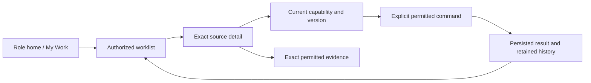

# Sense Studios UI/UX master transformation plan

Date: 2026-10-05 · Status: **PLAN ONLY — Owner review pending**

This strategy covers the expected S01–S27 product. Its detailed CURRENT UI evidence audit is pinned to accepted S22 commit **d21ccd1**, not the moving working tree. The latest Owner project context now reports S23 COMPLETE for development/local staging on 2026-10-05; this is a status update, not an inspected S23 UI audit. S24–S27 remain unauthorized. Revalidate S23 and later implemented surfaces against accepted source and captures after S27. This plan authorizes no transformation work. Execution requires completion and acceptance of applicable functional development through S27, a refreshed audit of that accepted application, resolution of the dependencies below, and **explicit Owner approval of the UI/UX transformation**. Delivering or approving this planning document alone does not start implementation. Detailed external product references are in the [Visual Reference & Benchmark Library](VISUAL_REFERENCE_BENCHMARK_LIBRARY.md); engineering migration/regression detail is in the [Engineering Migration & Regression Plan](ENGINEERING_MIGRATION_AND_REGRESSION_PLAN.md). Neither document authorizes implementation.

## 1. Scope, provenance and delivery boundary

Throughout this document:

| Label | Meaning |
| --- | --- |
| **CURRENT** | Implemented at d21ccd1 and inspected through source/tests or retained application captures. The evidence type is stated; source inspection is not a live usability test. Acceptance is development/local staging only. |
| **PLANNED** | Specified capabilities outside the accepted S22 audit baseline. S23 is now reported functionally COMPLETE, but its UI is not part of the inspected S22 evidence; S24–S27 remain planned/unauthorized. A specification or later status report is not inspected screen evidence. |
| **PROPOSED** | Future presentation, navigation, interaction, components, measurements or delivery recommendations. These remain subject to review and transformation approval. |

**CURRENT audit scope is S01–S17 and S19–S22, with S18 excluded.** The shorthand “through S22” must not imply accepted S18. S18's separate-branch completion/authorization conflict is unresolved. Latest Owner project status separately reports S23 COMPLETE, but this package has no S23 visual audit yet. Skills, SOP, knowledge and training are represented here as conditional product architecture, without assuming their source is integrated or their metrics available.

**Status update:** this plan's visual/source evidence audit is still anchored at S22, but the latest Owner-provided AGENTS.md now records S23 COMPLETE for local staging, with 186 API unit, 133 web unit, 261 PostgreSQL integration and 43 browser tests, 99 migrations current on 13 dedicated targets, 134 original-table snapshots preserved and ten reviewed captures. We have not independently inspected those new S23 captures or rerun its acceptance. Treat the S23 capability status as CURRENT per the Owner record and its transformed UI coverage as awaiting post-S27 rebaseline. S24–S27 are not authorized. Do not edit or interrupt those functional records/work.

**In scope now:** read-only research/audit, complete screen and journey strategy, proposed information architecture/design system, source-contract gap register, post-S27 execution/verification plan, and documentation.

**Out of scope now:** application code, styles, components, dependency installation, API/backend/schema changes, permission/business-rule changes, fixture seeding, migrations, deployment, database cleanup, and interruption of ongoing functional development. No runtime redesign or standalone interactive mockup is delivered by this task.

### Source hierarchy and evidence

Use the current Owner instruction, approved requirements/addenda and explicit slice decisions, approved architecture, intended architecture, implemented source, then assumptions. Relevant sources:

- [Approved requirements](../../../requirements/APPROVED_REQUIREMENTS.md), [clarifications](../../../requirements/CLARIFICATIONS.md), [implementation plan](../../../IMPLEMENTATION_PLAN.md), [requirement trace](../../../REQUIREMENTS_TRACE.md).
- [Current state](../../../CURRENT_STATE.md), [implementation status](../../../IMPLEMENTATION_STATUS.md), [module registry](../../../MODULE_REGISTRY.md), [product](../../../PRODUCT.md), [architecture](../../../ARCHITECTURE.md), [domain model](../../../DOMAIN_MODEL.md), [database](../../../DATABASE.md), [permissions](../../../PERMISSIONS.md), [workflows](../../../WORKFLOWS.md), [file storage](../../../FILE_STORAGE.md), [testing](../../../TESTING.md), and slice specifications/completion reports. These files can move with functional development; baseline CURRENT claims refer to their d21ccd1 content.
- [Evidence register](UI_UX_EVIDENCE_REGISTER.md): exact retained captures inspected, visual observations, gaps and post-S27 capture protocol.
- [Visual Reference & Benchmark Library](VISUAL_REFERENCE_BENCHMARK_LIBRARY.md): principles and adaptation by pattern across Linear, Asana, Notion, ClickUp, ADS and Polaris.
- [Engineering Migration & Regression Plan](ENGINEERING_MIGRATION_AND_REGRESSION_PLAN.md): future bounded migration, compatibility, rollback, regression and usability-study protocol.
- [API/Contract Gap Register](API_GAP_REGISTER.md): dependencies and safe presentation fallbacks that must be rechecked against accepted post-S27 contracts.
- [Documentation index](DOCUMENTATION_STRUCTURE.md): UX/product vs engineering context loading map and proposed durable subdocuments.
- [Refinement record](UI_UX_REFINEMENT_CHANGELOG.md): changes made, unresolved Owner decisions and recommended next planning action.
- [Historical v1 engineering handoff](../v1/ENGINEERING_HANDOFF.md): useful planning dependencies, with obsolete status statements explicitly superseded below.

S22's completion report records the historical final pinned `pnpm verify` exit 0: 176 API unit, 128 web unit, 247 PostgreSQL integration and 41 desktop/mobile browser cases. Its six reviewed captures and preservation evidence support local acceptance. **Those checks were not rerun for this planning task.** Production NAS, hosted deployment/CI, offsite backup/key custody/restore, external provider validation and the actual-project R-105 checkpoint remain separate gates. The S22 report's unintended local `postgres` migration remains unresolved; this task makes no database changes or cleanup claim.

### Prior UI planning reconciliation

IMPLEMENTATION_PLAN's “UI Specification v1” records **DESIGN REVIEW, not frozen**, fictional mockups and a prior direction for My Work for everyone with attention above tasks and equal desktop/mobile support. It also notes clean studio styling, but this is **one candidate visual direction**, not an approved direction to preserve. The visual-design phase must compare retaining it, evolving it substantially, and replacing it. No palette, typeface, density, list/board choice or global/project document navigation is frozen. See separate Gates A and B below.

Only ENGINEERING_HANDOFF.md is retained under docs/ui/v1. Referenced screen contracts, UI specification, research appendix, delivery plan and prototypes are missing from the inspected checkout. Their historical assertion counts are not verifiable current UI evidence. The retained handoff's “S18 complete/C-025–C-027; S19 onward unauthorized” opening is superseded by the current Owner instructions and accepted S19–S22 evidence. Its `/learning` reference is not a verified CURRENT route. This new package does not silently freeze or replace an absent approved design package.

### Two independent design approvals

**GATE A — UX Architecture approval:** approve the information architecture; primary/secondary/mobile navigation; user journeys; page/screen hierarchy; interaction patterns; progressive disclosure; return/context behavior; and role-aware information and action presentation. Test comprehension and capability/evidence fidelity with structural, neutral visual wireframes. Gate A approves structure only.

**GATE B — Visual Design approval:** separately compare candidate visual directions and approve typography, colors, spacing, density, borders, radius, elevation, icons, tables, forms, and motion. The existing cream/green/serif UI may be retained, substantially evolved or replaced. Gate B accepts a bounded visual direction for the approved prototype set only. It does not approve propagation or implementation.

Both gates require explicit recorded Owner decisions. They can be reviewed in sequence using the same representative workflow, but neither implies the other, neither authorizes implementation, and Gate B approval does not permit visual propagation. The future prototype review below is a further stop. **Implementation requires its own later explicit Owner authorization after Gate A, Gate B, and the representative-prototype gate.**

## 2. CURRENT audit: implemented structure and experience

### Frontend and route inventory

**CURRENT source evidence:** React 19/TypeScript, React Router 7 `BrowserRouter`, Vite responsive PWA, SimpleWebAuthn; global CSS plus module CSS, predominantly local React state and component-owned fetches. No shared component-library dependency is listed. Client/external portal and portfolio entry modules are lazy-loaded. This is a viable base to retain; a framework migration is not required by this strategy.

At d21ccd1:

| Actual entry/surface | Implementation evidence | Audit level |
| --- | --- | --- |
| `/`: passkey sign-in and signed-in workspace; approval queue, CRM, projects/tasks, devices, notifications, Owner audit/admin, staff team workspace | `apps/web/src/app.tsx`, signed-in view around lines 390–480 | Source/tests; no retained broad home capture inspected |
| `/bootstrap`, `/enroll`, `/owner-recovery` | `app.tsx` route declarations around 1195–1210 | Source/tests |
| `/documents`, `/revisions`, `/reviews`, `/client-reviews` | `app.tsx`, `document.tsx`, `revision.tsx`, `review.tsx`, `client-review.tsx` | Source/tests; no retained capture inspected |
| `/time`, `/workforce` | `app.tsx`, `time.tsx`, `workforce.tsx` | Source/tests and retained S16/S17 captures |
| `/turnkey`, `/site` | `app.tsx`, `turnkey.tsx`, `site.tsx` | Source/tests and retained S19/S20 captures |
| Offline capture/queue/conflict through `/site` session-unavailable fallback | `SiteRoute`, `site-offline-capture.tsx`, `site-offline.ts` | Source/tests and S22 cold/conflict captures; no invented separate offline URL |
| `/external-access` | `app.tsx`, staff workspace in `external-portal.tsx` | Source/tests and S21 staff captures |
| `/client-portal/*`, `/external-portal/*`, `/portfolio` | `apps/web/src/main.tsx:9–20`, respective portal/gallery modules | Source/tests; S21 external captures viewed, client/public visual coverage absent |

Template/stage/milestone workflows are composed into project UI rather than assumed standalone CURRENT routes. `/my-work`, `/projects/:id`, `/performance`, `/reports`, `/learning`, automation and assistant destinations below are **PROPOSED route shapes**, not baseline routes.

### Findings and implications

| Finding | Evidence and certainty | PROPOSED response | Priority after approval |
| --- | --- | --- | --- |
| Signed-in home mixes security, daily work and administration; header still carries IDENTITY phase badge and “capabilities will appear” copy | `app.tsx:390–480`, shell around 1190; verified source, not measured user confusion | Daily-work home; move account/security and organization governance into dedicated destinations | High |
| Workspace navigation is a flat series of module links; some modules repeat session gates and record-navigation headers | `app.tsx` route wrappers; verified source | Shared internal shell, project context and route continuity, keeping protected portal shells separate | High |
| Operational workflows contain many forms/cards on very long pages | S20 retained site captures, S17 workforce captures; visible fixture-level finding | Separate overview/list/detail/action contexts and contextual forms; mobile task flow before administration | High |
| Cream surfaces, dark green actions, serif display headings and pale bordered cards recur | `styles.css:1–35`, viewed S16–S22 captures | Use this evidence as one candidate in Gate B; select tokens only after comparison and user validation | Medium |
| Labels, visible status/error copy, named navigation and stacked mobile forms already exist | `app.tsx:181`, notifications/approval queue states, styles 640px rules, capture pairs | Preserve and standardize them; do not discard working error/offline guidance | High |
| Technical/test identities and IDs occur in capture controls | S21 portal fixtures and S22 capture context | Prefer meaningful authorized names with secondary short references; preserve exact identifiers in evidence detail | Medium; verify real-data presentation |
| Earlier S16 mobile nav crowding is visible in an older capture | Capture predates da15e02 navigation spacing fix | Recheck after S27; do not report it as a verified remaining S22 defect | Revalidation |
| Personal and management task scopes do not directly supply the proposed unified personal list | Baseline `task.service.ts:234–255`: Owner predicate unrestricted, staff mine primary-owned, assigned collaboration plus management | Conditional true personal read contract or honestly labeled existing scoped sections | High dependency |
| Review inbox is bounded active work, not complete project review history | Baseline `review.service.ts` inbox: active statuses, `take:100` before authorization filtering, returns items without total | Keep current scope truthful; complete register requires reviewed read model | High dependency |

These are planning findings, not a new functional defect acceptance report. No task timing, accessibility score, contrast compliance, real-project usability or production readiness has been measured. Twenty retained application images were inspected across S16–S22; not every S22 state image or every route was viewed. Full-page captures, fixture differences and older capture versions limit comparison. S01–S15 home/CRM/project/task/document/client/public and governance visual coverage must be completed at the future audit gate.

## 3. Complete product coverage and transformation map

Every future screen must retain the owning domain's commands/capabilities and evidence. Rows with **CURRENT** indicate functional availability, not approval of their proposed redesign. All presentation targets in the last column are **PROPOSED**.

| Slices / requirements | Capability classification | Future screen family and required fidelity |
| --- | --- | --- |
| S01–S04; R-004–009, R-079–081, R-091–093, R-099–102; C-001/C-008/C-023/C-024 | CURRENT identity/org/access/audit foundation | Passkey enrollment/recovery, sessions, organization → branch → team → employee, job-role bundles/overrides, grants, audit/retention. Keep Owner setup, immediate suspension and exit/lead-hold consequences explicit. Infrastructure remains operational tooling, not a new end-user module. |
| S05; R-096–097 | CURRENT typed approvals/queue | Decision inbox, exact request detail, eligible actor/action, reason and retained history. Notification read status never completes a request. |
| S06; R-010.a–d; C-017–019 | CURRENT CRM | Pipeline/list, lead detail/activity, contacts/source/lost reason, controlled conversion. Forward jump, skipped stages and completed activity remain different facts. Lost is terminal; a returning enquiry creates a new linked lead while preserving the original Lost record (C-018). |
| S07–S08; R-011–017; C-002/C-010/C-024 | CURRENT project/scope/template | Project directory/workspace; delivery type vs service scope; baseline vs approved change; one lead/owning branch; assignments/transfer; template versions, stages/milestones and explicit lifecycle. Required-milestone override remains reasoned/authorized. |
| S09–S10; R-018–026; C-011/C-016/C-023 | CURRENT tasks/dates/dependencies | My Work, task list/detail, primary owner/collaborators, separate target/committed dates, extension requests, Waiting reason/resume, recurrence, dependency context, exit reassignment and cancellation closeout. |
| S11–S13; R-027–030/R-035–039; C-003/C-009 | CURRENT documents/revision/internal review | Project documents/folders, resumable upload/recovery, exact drawing register/history, internal review/correction, issue/transmittal/acknowledgement. Preserve exact revision/checksum/round and Confidential ancestry. |
| S14–S15; R-031–034/R-040/R-075–076; C-013–015 | CURRENT client portal/gallery | Portal submissions/items, item delegation, passkey-bound decisions and Primary final package approval, issued files/handover, own history, private gallery, separately approved public derivatives. Cancelled/expired access must retain its existing limitations. |
| S16; R-041.a–d/R-042.a–c/R-043.a; R-003/R-043.c boundary | CURRENT time and local time-transfer contract; production accounting binding pending | Timer/manual/non-project entry, history, reasoned corrections, lock/reapproval and Owner accounting export/retry. Preserve elapsed time and automatic lifecycle pause. R-043.b approved procurement transfer is outside S16 and requires its separate accepted contract; full accounting/payroll duplication is prohibited, not a proposed missing feature. |
| S17; R-046–051; C-022 | CURRENT workforce | Own attendance/leave/WFH, schedule/holiday/policy, dated allocations and workload/capacity, authorized management review. Preserve schedule-derived minutes, carry-first expiry, dated allocations, prospective policies, future-only cancellation and restricted selfies. |
| S18; R-044–045/R-055–057 | PLANNED, conditional/excluded | Reserve Skills & Learning: profile/ratings, controlled upgrades, SOP versions/acknowledgement, knowledge publication, training/assessment. No current route/metric or integration assumed. Training completion must not imply automatic skill upgrade. Separate Owner reconciliation required. |
| S19; R-015.b–g/R-096–097 | CURRENT turnkey | Exact-design release/BOQ, protected cost/materials, typed cost/procurement approvals, factory/procurement progress, replacement/reapproval and explicitly approved client cost snapshot. No redesign invents inventory/accounting authority. |
| S20; R-068–070/R-105; C-020/C-021 | CURRENT local site workflows | Packages, factual progress/manpower, report draft/confirmation, snags/repair, independent verifier appointment/check, authorized management closure and separate handover. Actual-project R-105 remains unverified. |
| S21; R-075–076/R-038–039/R-079–080; C-006/C-012/C-016 | CURRENT external portal | Consultant/vendor/factory exact grants, advisory requests/submissions/uploads, production views within grant, exact transmittals/own acknowledgements, native-share expiry/revocation notices and bounded closeout. Advisory input is not approval. |
| S22; R-071/S22.a/R-072.a–b/R-098.a–g | CURRENT bounded offline capture | Explicit online preparation, supported notes/new images/manpower/report drafts/OPEN snags/factual progress, durable queue, current-authority sync, human conflict comparison/keep/amend and receipt. |
| S23; R-061–067/C-005 | CURRENT functional status per latest Owner record; S22 audit did not inspect S23 screens | Policy/group configuration/approval, own and current-scoped management results, separate Design/Turnkey health, delay attribution, evidence explanations/trends and review cycles. This strategy makes no independent S23 visual/source verification claim. Rebaseline its screen evidence after S27. No scores without approved configured inputs; unavailable S18 input stays unavailable. |
| S24; R-058–060/R-073–074/R-077 | PLANNED | Role home summaries, shared attention/decision center, operational report filters/export and immutable snapshots. Field filtering and complete/loaded-only totals belong to accepted read contracts. |
| S25; R-084–086 | PLANNED | Calendar/calendar connection, website enquiry mapping, maps context, adapter configuration and delivery/failure status. WhatsApp, deep CAD/BIM and optional wrappers remain conditional future scope. |
| S26; R-078/R-082–083 | PLANNED | Rule/version/run management, approval proposals and custom report builder (Data → Filters → Columns → Grouping → Charts → Saved Report). Advanced builder is Phase 2; reconcile accepted scope after functional development. |
| S27; R-052–054/R-087–090 | PLANNED | Internal role assistant, sourced recommendation detail, proposed action and human outcome. Provider-independent; no approved client assistant, hidden chain-of-thought or autonomous high-impact action. |

Cross-cutting requirements R-006/R-092 and relevant addenda apply to every row. Expand the exact subclauses in each later implementation brief; this map is a planning trace, not an executable acceptance substitute for slice specifications.

## 4. PROPOSED information architecture and role homes — Gate A

### Internal navigation

Use a persistent desktop navigation rail, compact tablet navigation, and a mobile primary bar with **My Work / Projects / Decisions / More** as the provisional arrangement. “More” contains all authorized secondary destinations with clear labels; key site/time actions remain reachable within their relevant work context. Do not hide essential approval, privacy or conflict detail merely to fit mobile chrome.

Proposed groups:

1. **Work:** My Work, Projects, Decisions, Leads & Clients, Documents.
2. **People:** Time, Workforce; Skills & Learning only if S18 is separately resolved and accepted.
3. **Insights:** Performance, Project Health, Reports after accepted S23/S24.
4. **Manage:** Organization & Access, Templates, Integrations, Automation, Audit & Retention, based on actual grants.
5. **Account:** passkeys/recovery, sessions, notifications/preferences, sign out.

Turnkey and Site are primary project workspace areas; authorized cross-project worklists can remain secondary entry points when a complete scoped source exists. Avoid duplicate divergent records in a “global” and a “project” UI. A global Documents destination initially opens an authorized project picker unless an accepted cross-project index exists. Search/command palette is conditional on scope-safe search; it must not crawl every project's files in the browser.

Branch context may narrow authorized results. It never grants branch access or substitutes for explicit cross-branch assignment. Organization/branch/team is displayed as context, not extra Brand/Department tiers. Configurable job titles do not assign navigation/action rights by themselves.

### Role homes

**PROPOSED** role modes compose accepted capabilities; they are not a new role or permission model. Every internal account retains My Work. Personal and management sections remain explicitly distinct, especially for an employee-less Owner.

| Persona | First useful information/action | Supporting destinations | Boundaries |
| --- | --- | --- | --- |
| Owner | Authorized decisions/risks, lead holds/exit recovery, S24 organization health/workload | Projects, CRM, policies, reports, organization/security | Own work is not entire organization work; financial fields and score configuration remain controlled |
| Team Leader / Project Lead | Explicitly assigned review/decisions, team/project blockers, leave/workload impact | Projects, scoped workforce, relevant operations | Title alone grants nothing; management and reviewer duties stay distinct |
| Employee / collaborator | Attention, own/collaborating tasks, correction, today/due/Waiting, timer | Project detail, own time/leave/attendance, own performance later | No inferred ability to assign others or view named peers' scores |
| Site staff / named verifier | Relevant packages, capture/report/snags and named checks | Site detail, online preparation, queue, handover when permitted | Verifier role does not grant management closure; offline support remains bounded |
| Client / Primary Client / item delegate | Exact submissions requiring their action, approved/issued files, own decisions/gallery | Portal project/item/package and security | Delegate item approval is not Primary final package approval; no internal admin/performance/AI |
| Consultant | Granted exact files and staff requests, advisory submission/status | Portal project, own uploads/transmittals | No formal approval or unrestricted folders/CAD download |
| Vendor/factory | Granted production requirements/releases and advisory response | Portal bounded production context/own acknowledgements | No ungranted protected prices or authority to validate production |
| Public visitor | Approved portfolio derivatives | Portfolio detail | No authenticated/project/private data |

S24 source requirements also describe Owner, Team Leader, Employee, Client and Site dashboard fields. Implement their approved subset after S24 acceptance, not arbitrary universal widgets. Prefer meaningful task/decision summaries to decorative metrics. No universal “project percentage” derived from milestone counts or loaded tasks.

### Project workspace and detail model

Proposed project frame: name/code, owning branch, lead, delivery type, lifecycle/hold banner, current scope and authorized contextual actions. Tabs: **Overview / Plan & Tasks / Documents / Reviews / Delivery / Activity**. Delivery exposes Turnkey/Site only when applicable; Team & Scope and external access are management subpages. Health appears only with accepted S23 source and explicit evidence coverage.

Overview leads with next permitted actions, genuine deadlines/blockers, milestones and source freshness. Plan & Tasks carries list/filter defaults; dependency graph and board are conditional presentations with text/list alternatives. Documents separates ordinary files, drawing revisions and formal transmittals. Reviews separates internal rounds, client items and final packages. Activity shows authorized history, not unrestricted audit payloads.

Desktop may use list + detail pane for read/triage; deliberate consequential forms open a focused full detail or modal with reliable focus management. Mobile detail is a full page with Back returning to preserved filters/scroll/selection. Shareable detail routes must identify canonical records, not volatile list indexes. Proposed URL shapes and legacy aliases are decided during the post-S27 route contract review; preserve existing direct links and portal/native-share flows throughout migration.

## 5. PROPOSED screen and interaction contracts

All presentation contracts below consume real source identity, capability, version, date basis and completeness metadata. If these are unavailable, use the stated fallback rather than fabricate them.

| Screen family | Essential content/action | Loading/empty/error/conflict/mobile obligations |
| --- | --- | --- |
| My Work | Attention above own/collaborating tasks; review/correction/Waiting/date basis; timer and source-linked action | Source groups fail independently; incomplete total unavailable. Honest no-personal-work state for employee-less Owner. Cards on mobile, configurable compact desktop list proposed. |
| Decisions | Request type/source, actor, impact, evidence, version, reason and exact eligible decision | No generic bulk approval. Changed/revoked request refreshes and blocks stale decision. Return retains inbox filter. |
| Lead/client detail | Source/stage/history, next permitted action, contacts and conversion | Preserve Lost/jump/copy rules; pending conversion cannot look complete. Mobile staged form with persistent context. |
| Project list/detail | Delivery type/scope/lead/branch/lifecycle, plan, access, change history | Holds/cancellation take precedence over activity actions. Counts state authorized/full vs loaded. No hidden-project names in empty states. |
| Task detail | One owner/collaborators, state, target vs committed dates, extension/Waiting/dependency, evidence and history | Show reason/authority prerequisites at point of action. Distinguish ordinary Waiting vs exit reassignment, stopped delivery vs closeout. No drag-to-approve/reassign implicit command. |
| Documents/register | Authorized folder/file metadata; selected exact revision, checksum, approval/issue/supersession; upload status | Pending bytes/finalization is not READY. Retry current upload identity. No raw storage paths. Denied stream clears viewer; unsupported format has safe existing authorized fallback. |
| Review/evidence workspace | Exact round/revision; feedback, reviewer eligibility, correction linkage, selected item/package authority | Historical read-only state is prominent; no latest-file substitution. Unsupported/failed viewer disables location tools. Mobile evidence/feedback switch retains exact context. |
| Time/workforce | Timer/live state and elapsed time, log/date/schedule basis, policy version, balances/allocations and approval history | Network status does not promise offline timers/attendance. Postlock correction/reapproval explicit; selfie access restricted. Mobile capture/request prioritized over policy forms. |
| Turnkey/site | Exact approved release/materials; authorized cost/procurement; package facts/report/snags/checks/closure/handover | Separate state badges for each workflow. Online confirmation/approval/completion never appears available offline. Mobile capture and named check have short focused steps. |
| Client/external portal | Granted projects/evidence, clear action ownership, submissions and own history | Separate shell/auth/session boundaries. Expiry/cancellation/access loss explicitly suppress prohibited actions; reasoned staff actions remain internal. |
| Offline queue | Preparation identity/context; local save truth, captured image/upload/command stages, last sync, receipts | “Saved on this device” differs from “Synchronized.” Durable storage failure is explicit. Conflict shows permitted server/local values, current version and keep/amend options; no automatic overwrite. |
| Performance/health | Policy/formula version, evidence coverage, score status, relevant period, own/scoped comparison, explanation/delay source | Unconfigured/insufficient evidence remains unscored, not zero. Ranking restricts named identities. Historic snapshot does not recompute on display. |
| Reports/export | Report scope/filters/date/timezone/as-of, complete data basis, output format and immutable snapshot identity | Export unavailable/running/failed/completed distinctly. Recheck field permissions; file does not inherit extra authority. Mobile filter/detail with readable print/export output. |
| Integrations/rules | Adapter/rule version, permitted config, delivery/run history, failure cause/recovery and approval boundary | Secrets masked; “connected” is not successful delivery. Replay/current-version handling owned by functional services. No new approval-bypass shortcut. |
| Internal assistant | Query context/scope, cited permitted evidence, freshness/uncertainty, proposed action and human outcome | Generated advice visually distinct from recorded state. Accept/reject/override explicit; high-impact proposal routes through existing approval, never executes silently. No external/client assistant. |

### Common state vocabulary

Use semantic state plus human-readable explanation, not a universal “Done” badge. Keep internal-approved, client-item-approved, package-final-approved, issued, acknowledged, site-verified, site-closed and handed-over distinct. Display pending extension beside the existing committed date; requested date is not accepted date. Display stale data with last successful refresh, and partial data with its scope. Loading/error/denied/unavailable are never empty/zero.

Unauthorized features are omitted where revealing existence would leak scope. An otherwise visible record with a legitimate unavailable action may explain the safe reason/prerequisite without revealing restricted actors/records. Retry is an explicit existing command; after access loss clear records, protected pixels/object URLs, previews and relevant selection state. Do not add automatic cross-project/session draft persistence.

## 6. PROPOSED connected journeys and acceptance scenarios

| Journey | Connected experience | Required boundary checks |
| --- | --- | --- |
| J01 Daily decision | Sign in → role attention → exact request/review → permitted decision → persisted history → filtered return | Own vs organization scope, named actor, revoked evidence, changed version, notification read independence |
| J02 Design delivery | Lead → project/template/scope/team → task → internal review → correction/new round → client exact item/Primary final package → issue/transmittal → handover | Self-review denial, CR own review, exact item/revision, delegation vs final authority, superseded evidence, required milestones |
| J03 Turnkey/site | Approved design/BOQ → cost/procurement → factory/package → factual report → repair → independent check → management closure → separate handover | Protected prices, material/design completeness, report confirmation, verifier independence, verifier-only closure denial |
| J04 Offline field capture | Prepare online → supported capture → local queue → reconnect/current authority → exact retry or compare/keep/amend → canonical receipt/history | Storage/quota error, photo retry, lost response, account switch/logout, redacted conflict, revoked access, no approval/completion offline |
| J05 Time/workforce | Timer/log → correction/approval → leave/schedule/allocation → workload impact → actionable notice; separate Owner export | Schedule-derived basis/overnight date, carry/expiry/cancellation, lock/reapproval, lifecycle pause, accounting idempotency |
| J06 Scoped collaboration | Portal login → granted project/exact file → advisory submission or exact authorized client decision → own status/history | Separate identity cookies, hidden grants/prices, cancelled/expired access, native-link revocation notice, no new external authority |
| J07 Intelligence | Approved prospective policy → available evidence snapshot → explain score/health/delay → scoped cycle → report/frozen export | Unscored states, external delay handling, immutable snapshot, anonymous vs named scopes, unavailable S18 input |
| J08 Human-controlled assistance | Summary → source → automation/AI proposal → eligible approval → accepted/rejected/overridden result | Scope-safe retrieval, malicious evidence input, no hidden reasoning storage, no high-impact action on suggestion acceptance alone |

J07/J08 are **PLANNED functional journeys with PROPOSED presentation**. J01–J06 draw on CURRENT local capabilities, but their integrated transformed layouts have not been built or verified. Optional real-project studies require approved lawful data/access and cannot be inferred from seeded acceptance.

## 7. PROPOSED design system and component architecture — Gate B

There is **no recommended/frozen visual direction yet**. After Gate A and the post-S27 rebaseline, evaluate three real alternatives: retain the existing cream/green/serif treatment, evolve it substantially, or replace it. Compare legibility and hierarchy using identical representative screens, fixture content, desktop/mobile widths, and consequential/error states. Include at least one direction not built from the current palette/type treatment. Record benefits, tradeoffs, evidence, selected option and rejected alternatives for Owner decision. No palette/font is frozen here.

| System layer | Provisional specification to review |
| --- | --- |
| Tokens | Semantic canvas/surface/raised/ink/muted/border/action/focus/danger/warning/success/info. Compare token mappings for each candidate direction; light/dark mode is an Owner choice. No status depends on color alone. |
| Type | System sans or reviewed locally served font for forms/data; studio serif limited to major identity/page titles. Provisional 16px body, 14px dense metadata, 20–28px working titles, line-height about 1.45–1.6. Avoid tiny uppercase metadata for crucial information. |
| Spacing | Provisional 4/8/12/16/24/32/48px scale; consistent field, card and section rhythm. Keep evidence/context near the corresponding action. |
| Layout/density | Content-driven grids; comfortable mobile default, reviewable compact desktop density. Data working areas may be wider than current 880px identity container. No universal page-wide form stack. |
| Controls | Primary/secondary/tertiary/destructive distinctions; one clear next action per context. 44px product touch-target goal; keyboard-visible focus. Disabled states explain prerequisites where safe. |
| Feedback | Text+icon state chips, inline field errors, section error/retry, persistent consequential result, low-priority toast only as supplement. No disappearing-only approval/conflict messages. |
| Icons/motion | Small consistent icon family with labels; no icon-only irreversible action. Reduced-motion support; short functional transitions, no decorative blocking animation. |

Proposed shared primitives: Button, LinkAction, Field/FieldError, Select/Combobox, Textarea, Checkbox, Dialog/Drawer, Tabs, Breadcrumb, StatusChip, Notice, EmptyState, LoadingState, ErrorPanel, List/DataTable, FilterBar, Pagination and responsive detail layout. Native semantic elements first; specialized keyboard widgets need reviewed APG behavior. Do not select a new library merely because these primitives are listed.

Proposed domain patterns: capability-aware action area (presentation of server authority), DateBasis, ExactRevisionIdentity, EvidencePanel, ApprovalImpact/DecisionForm, HistoryTimeline, Scope/FreshnessSummary, UploadProgress, OfflineQueueItem/ConflictComparison, ScoreExplanation, ReportScope and RecommendationEvidence. Domain-specific state/evidence lives in domain adapters, not a generic UI component that invents eligibility.

After approval, retain React/Router/Vite/PWA and existing service contracts. Introduce shared shell/primitives incrementally, then adopt them module by module. Consolidate session/error handling only after checking current purge/revocation behavior and portal separation. Use adapters to normalize display data, with domain command hooks retaining version/CSRF/idempotency identities. Never move authorization/calculations into client helpers. Code splitting, viewer/library selection and caching changes are separate reviewed implementation choices with bundle/security evidence.

Protected data must not become persistent browser caches by adding generic state tooling. Current S22 allowlisted local capture is the explicit exception; downloaded files, API responses, credentials/CSRF, private workforce or financial content must not be swept into it. Draft retention scope must be separately settled before implementation.

## 8. PROPOSED responsive, accessibility and content standards

Target WCAG 2.2 AA, assessed per complete page/process, with automated checks plus manual keyboard/screen-reader review. Review contrast, labels, errors, reflow, target size, focus visibility/obscuration and accessible authentication. Reference: [W3C WCAG 2.2](https://www.w3.org/TR/WCAG22/). Product target sizes may exceed minimum criteria; current conformance is **unmeasured**.

At 320/390/768/1024/1440px, test long names, multiple roles/projects, sparse/dense data, large text/zoom, sticky chrome, landscape and on-screen keyboard. Wide tables may have deliberate labeled internal scrolling or alternative labeled cards; ordinary pages must reflow. Diagrams/charts need equivalent text/list data; drag-only operations need a keyboard/touch alternative. Use [W3C APG patterns](https://www.w3.org/WAI/ARIA/apg/patterns/) for complex keyboard widgets, with native controls where sufficient. Do not equate ARIA attributes with verified usability.

Dialogs trap/restore focus correctly; navigation communicates new title/location; drawers do not leave hidden interactive content reachable. Date pickers permit typed input. Preserve password-manager/passkey affordances. Upload/capture status remains understandable without vision, and verification photos/evidence retain authorized alternatives already specified by the domain.

Content rules: action verbs match actual commands; visible dates state target/committed/as-of and use approved organization timezone where required; numbers preserve approved units/rounding; deadlines do not silently shift due to browser locale. Friendly names never replace exact evidence identity. Explain abbreviations and distinguish provisional/confirmed/approved facts. An empty state states what scope was checked; a missing dependency states what is unavailable, not a fabricated result. Translation/localization is an Owner decision; do not invent multilingual rollout or change units.

Performance is part of usability. After S27 establish a representative baseline for route load, initial actionable content, input responsiveness, layout stability, low-bandwidth uploads and offline startup. Provisional targets: no meaningful regression against accepted baseline; assess LCP ≤2.5s, INP ≤200ms and CLS ≤0.1 at the 75th percentile when lawful real-user measurement exists. [Web Vitals definitions](https://web.dev/articles/vitals). Lab checks remain lab evidence. UI analytics must avoid protected evidence, identities and private workforce/financial payloads; no analytics instrumentation is authorized now.

## 9. PROPOSED contract dependencies and Owner decisions

Presentation approval cannot authorize a new backend read model or business feature. Recheck dependencies G01–G12 after S27. They live in the [API/Contract Gap Register](API_GAP_REGISTER.md), which includes the source evidence, safe presentation fallback and functional owner to consult. For each gap, the post-S27 decision is one of: already supplied by accepted functional work; presentation-only; or separately authorized functional work. Prefer a truthful fallback over expanding scope. The product master keeps this dependency pointer so engineering details can be loaded only when needed.

### Owner review choices — pending, not automatically decided

| ID | Recommendation | Decision needed before affected transformation work |
| --- | --- | --- |
| D01 | Compare retaining, substantially evolving, and replacing existing cream/green/serif | Visual direction, typeface and approved brand assets at Gate B |
| D02 | Comfortable mobile plus optional compact desktop; list default for evaluation | Task density and list/board emphasis; boards cannot imply new transitions |
| D03 | Project-first documents with authorized project-picker global entry | Global/project document navigation and accepted index/search scope |
| D04 | My Work for everyone; scoped management overview distinctly labeled | Final role-home/attention hierarchy using accepted S24 fields |
| D05 | Project-based operations, secondary cross-project queues when supplied | Navigation labels, placement, mobile primary destinations |
| D06 | Accessible exact viewer with textual feedback alternative | New viewer/region/compare scope and separately required data contracts |
| D07 | Preserve approved functional subset; unavailable S18 stays explicit | S18 reconciliation and any custom-report Phase 2/AI scope discrepancy |
| D08 | Preserve functional semantics and migrate incrementally | Explicit transformation start approval after functional S27 acceptance and refreshed design package |

These remain unresolved Owner choices rather than blockers to this planning pass. No approval is presumed from lack of reply. Numeric design/performance goals are proposals, not new business policy defaults.

## 10. PROPOSED post-S27 execution roadmap

No calendar start date is assumed. Estimates require accepted final scope, dependency inventory and team availability. This planning task ends before all waves below.

### Gate 0 — functional finish and baseline refresh

Confirm Owner-directed functional completion through S27 with exact accepted commits/reports, including any phased exclusions. Reconcile S18 separately; this plan cannot activate it. Pin a new accepted baseline, reread current requirements/decisions, recapture all personas/screens/states and inspect the final source/contracts/tests. Check that planned S23–S27 functionality actually exists; reclassify matrix rows only from evidence. Record unresolved gaps/defects separately, without turning redesign into unauthorized functional work.

### Gate 1 — UX Architecture approval, Gate A

After the post-S27 rebaseline, resolve architecture decisions affecting information structure and task comprehension. Produce neutral structural prototypes/wireframes and connected flows. Obtain and record **Gate A** approval for the complete architecture before visual-direction approval. Gate A does not freeze styling or authorize implementation.

### Gate 2 — Visual Direction approval, Gate B

Compare three directions (retain, substantially evolve, replace current cream/green/serif). Prototype typography, colors, spacing, density, borders, radius, elevation, iconography, tables, forms and motion on representative content. Obtain and record **Gate B** approval separately from Gate A. Both Gate A and Gate B remain design decisions only.

### Gate 3 — representative prototype stop

Before any design system is propagated across the application, create high-fidelity, clickable representative prototypes for **App Shell, My Work, Project Workspace, Task Detail/Create, and Review Workspace**. Cover complete desktop and mobile states where applicable, including realistic role variants, evidence/state distinctions, loading/empty/error and restricted views. Review an integrated end-to-end path through the five prototypes and confirm each against Gates A and B.

**STOP and return the five prototype set to the Owner.** The next action must be Owner review. Do not propagate the visual direction to other application areas, create a whole-app component rollout, or begin T01 until the Owner explicitly approves this representative prototype set and separately authorizes implementation. If the Owner requests revisions, revise only the prototype set and return it for review. Gate A and Gate B approval do not waive this stop.

### Gate 4 — implementation authorization

After Gate A, Gate B and the representative-prototype review are accepted, settle applicable D/G decisions, confirm field/action/source mappings and migration/regression constraints, then request a separate explicit Owner start instruction. Only that instruction may begin an implementation wave. **Neither this master plan nor any prototype or old mockup approval substitutes for it.**

### Delivery waves after authorization

| Wave | Bounded scope | Dependencies / review gate |
| --- | --- | --- |
| T01 Foundations and shell | Approved tokens/primitives, internal/portal shell boundaries, route bridge, account/security placement | Frozen visual contracts, session/purge regression, legacy links and passkey setup/recovery |
| T02 Daily work and decisions | My Work, personal/management sections, exact request/detail/attention, task detail/review/correction | Accepted personal/attention/read contracts; no capability or evidence drift |
| T03 CRM and project workspace | Lead conversion, project/scope/team/template/stages/milestones and connected task context | Permissions/lifecycle/exit/cancellation, filters/return, backend totals |
| T04 Documents and design delivery | Folders/upload/register, authorized viewer if approved, internal/client review, issue/transmittal | Exact evidence, Confidential/revocation, self-review/delegation/final authority, no unapproved region tool |
| T05 Time, workforce and operations | Time/leave/capacity, turnkey/procurement/site and offline queue | Calculations remain server-owned; protected price/selfie scope; verifier/closure; queue/purge/idempotency/conflicts |
| T06 External and public surfaces | Client/consultant/vendor/factory portal coherence, gallery/portfolio, grants/notices | Separate identities, access expiry/cancellation, publication derivatives and native-share revocation |
| T07 Insights and guarded tools | Accepted performance/health, role dashboards/reports, integrations/rules/internal assistant | Policy/snapshot fidelity, scoped exports, failure/run evidence, human approval and adversarial access |
| T08 Consolidation and acceptance | Remove superseded presentation only after route parity, full regression, accessibility/responsive/usability review, docs | Owner accepts complete transformed scope; production rollout separately authorized |

Learning/SOP/training is a separate conditional wave only after S18 reconciliation/functional acceptance and explicit scope inclusion. Do not fill its absence with demo functionality. Functional blockers return to the owning slice or a separately approved follow-up, rather than being hidden inside a style change.

Each wave starts with exact requirement sub-IDs, included/excluded screens, source/callers, data/access consequences and test plan. Sol handles requirements, permissions, schema/contract decisions, difficult debugging/security and acceptance. Luna handles bounded settled UI/document/test work. Aim for the Owner's approximately 70% Luna/30% Sol allocation without claiming a measured ratio or reducing checks.

Detailed route migration, deep-link compatibility, PWA/cache compatibility, rollback and regression matrices live in [Engineering Migration & Regression Plan](ENGINEERING_MIGRATION_AND_REGRESSION_PLAN.md), separate from the UX/product specification in this file.

## 11. PROPOSED UX research and final acceptance

Before final UX acceptance, representative real users must complete unassisted, task-based sessions with the accepted, implemented product. Participants should reflect real roles/workflows (Owner, permitted manager, employee/collaborator, site/verifier and relevant client/external users). Use real-user evidence gathered with consent and approved data; mockup-only feedback or an agent's successful run cannot replace this gate. Do not coach users. If they request assistance, record the request and its timing, then follow a consistent protocol that records the help rather than hiding it.

Measure the baseline before targets are proposed. For each task and persona, record: completion success and time; hesitation and pauses; wrong navigation and backtracking; misunderstood terminology; information missed or misread; unnecessary steps; assistance requested; abandonment; and serious decision/evidence/authority errors. Preserve task script, participant role (pseudonymized), device/viewport, fixture/data class, observation notes and task outcome. Separate observations from interpretation and avoid recording sensitive personal or project data in research artifacts.

Define each measure operationally before testing: task start/end; what counts as completion; how hesitation is observed; error severity (especially decision/evidence/permission errors); assistance coding; and how results are grouped. Report participants, sample size, non-completions and exclusions. Do not invent percentage improvement targets now. After a sufficient representative baseline exists, review distributions and serious-error cases with the Owner and representative users; set explicit absolute or relative acceptance targets and minimum sample/coverage, then record their rationale and Owner approval before judging the redesigned result. Do not derive targets by rounding small samples into apparent precision. Final acceptance requires users to complete critical tasks without assistance, no unresolved serious decision/evidence/authority error, and attainment of the baseline-derived targets approved for the specific tasks. Targets and performance thresholds are different from product permission/business policy.

Engineering/API/accessibility/responsive/regression verification is specified separately in [Engineering Migration & Regression Plan](ENGINEERING_MIGRATION_AND_REGRESSION_PLAN.md) and [API/Contract Gap Register](API_GAP_REGISTER.md). A visual screenshot cannot prove behavior; automated/component tests cannot prove unassisted usability. Final completion needs both independent lines of evidence, plus explicit Owner acceptance. The detailed proof matrix lives with the engineering plan so future UX planning need not load it by default.

## 12. Risks, mitigations and planning disposition

| Risk | Mitigation / gate |
| --- | --- |
| S23–S27 change fields/workflows before transformation | Pin visual evidence at S22; record current S23 completion status separately; mandatory post-S27 rebaseline before design freeze |
| S18 assumption contaminates metrics/navigation | Conditional excluded row, unavailable inputs, separate Owner reconciliation |
| Attractive summaries hide scope/incomplete data | Completeness/freshness/date-basis contracts and safe fallback; no guessed totals/percentages |
| Shared UI blurs approval/evidence boundaries | Domain-specific decision/exact-revision patterns and adversarial permission/evidence review |
| Shell/viewer migration weakens portal/session/cache isolation | Preserve separate identities, grant-loss cleanup and S22 storage allowlist; test old/new cache/queue compatibility |
| Long forms remain difficult on small screens | Focused list/detail/action flows, mobile capture priority and tested return context |
| New visual system loses proven states or creates large rewrite | Incremental waves, state catalog before replacement, retained compatibility/rollback |
| Retained screenshots overstate coverage | Evidence register distinguishes viewed/source-only/missing; new live isolated audit required |
| New search/chart/viewer/report tools become hidden functional scope | G-register, owning-slice contracts and separate approval for data/evidence extensions |

**Planning disposition:** complete master strategy prepared for Owner review; execution readiness is conditional on functional acceptance through S27, refreshed evidence, resolved design/dependency choices and explicit transformation approval. CURRENT local capability evidence, PLANNED functional scope and PROPOSED redesign remain separate. No application transformation, new business authority, production deployment or S18 integration is claimed.

**Actual routing:** exact `gpt-6.1-sol` agent performed project-context intake, requirements/conflict interpretation and planning guidance; exact `gpt-6-luna` agents performed bounded source and retained-capture inventories/documentation. Final source-fidelity review is recorded in the companion review document. Allocation ratio was not measured; no claim is made about changing the existing chat's model.

**STOP:** the planning task ends with delivery of this package. Wait for the Owner; do not start T01 or any redesign work.
